# Module A reference caption 전수 모니터링

- 시작: 2026-10-12T18:27:48+09:00 (Asia/Seoul)
- 요청 모델: `gpt-6-luna` / 이미지 + identity_term만 API에 전달
- 대상: DreamBench 30장 + DreamBench++ 150장; target prompt는 전달하지 않음
- 각 이미지의 첫 응답을 보존하며 자동 수정·검증 재시도 없음
- 진행: 180/180; 구조 검증 결과: `{'PASS': 179, 'INVALID': 1}`
- System prompt SHA-256: `8b114e3740a5cf32015ae65809abf1406587cedc5fddc6e635d7bcce6a8413c0`
- [프롬프트 원본](prompts/module_a_caption_system_prompt.md) / [실행 프롬프트 snapshot](../datasets/caption_monitoring/module_a_v1/system_prompt.txt)
- [전체 JSON](../datasets/caption_monitoring/module_a_v1/captions.json) / [JSONL](../datasets/caption_monitoring/module_a_v1/captions.jsonl) / [UNO reference manifest](../datasets/dreambench_uno/manifest.json)

PASS는 JSON 키·문자열·identity exact-match 검증 통과입니다. 시각적 정확성, 누락, 상세도, 후치 수식, 불필요한 style 표현은 아래 이미지와 비교하여 검토해야 합니다. Caption은 원본 응답 그대로이며 각 항목의 검토 칸은 수동 검토 전 상태입니다.

| 구분 | 항목 수 | 완료 |
|---|---:|---:|
| dreambench / subject | 30 | 30 |
| dreambench_plus / live_subject/animal | 45 | 45 |
| dreambench_plus / live_subject/human | 20 | 20 |
| dreambench_plus / object | 65 | 65 |
| dreambench_plus / style | 20 | 20 |

## 구조 검증 실패 항목

Caption은 보정하거나 재생성하지 않았습니다. 대소문자 차이도 현재 exact-match 계약상 실패로 기록합니다.

- `dreambench_plus/object/03` / `cherry blossoms`: ValueError: identity_term must occur verbatim in text; revise identity_term or prompt

## 001. dreambench/backpack

- Identity: `backpack`
- 이미지: [02.jpg](../datasets/dreambench_uno/images/backpack/02.jpg) (1280 × 1280)
- 상태: PASS

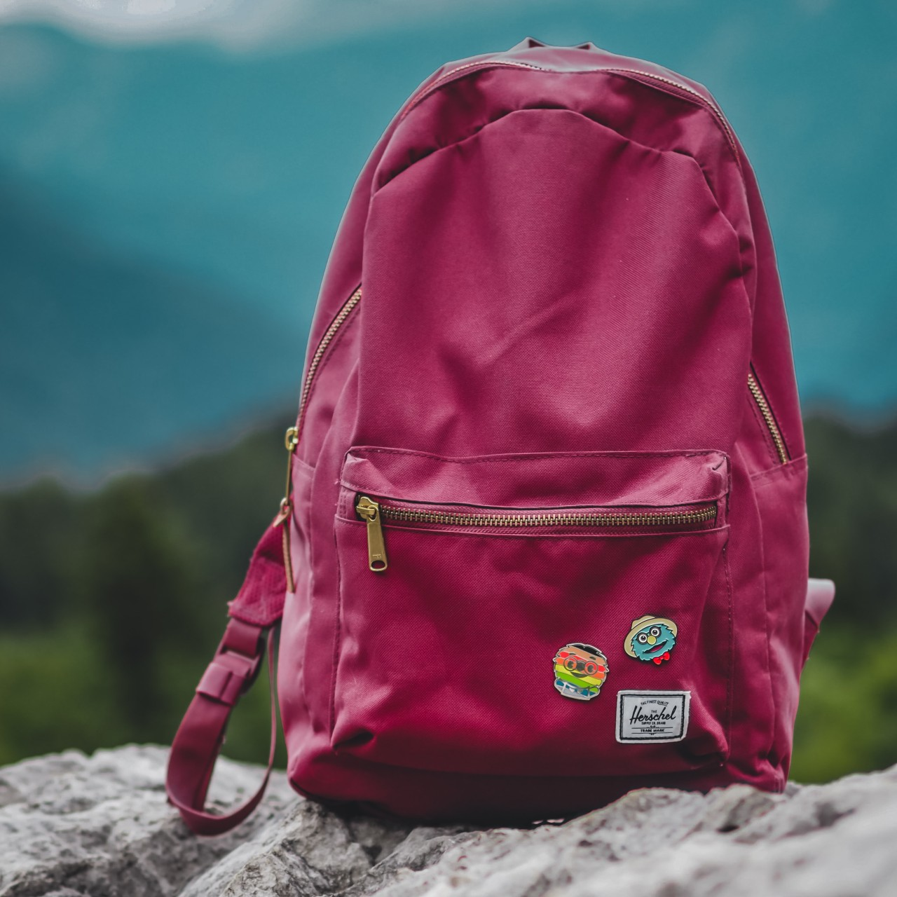

```text
A magenta backpack with gold zippers and colorful pins stands on a rocky ledge against a green, mountainous background.
```

검토: □ 시각적 일치 □ 외형·동작·배경 범위 □ 관사·후치 수식 □ 불필요한 style 묘사 없음

메모:

## 002. dreambench/backpack_dog

- Identity: `backpack`
- 이미지: [02.jpg](../datasets/dreambench_uno/images/backpack_dog/02.jpg) (1440 × 1440)
- 상태: PASS

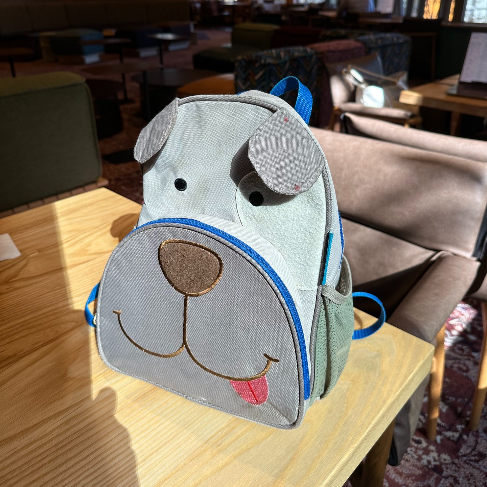

```text
A gray backpack with blue trim and a floppy-eared dog face sits on a wooden table in a lounge
```

검토: □ 시각적 일치 □ 외형·동작·배경 범위 □ 관사·후치 수식 □ 불필요한 style 묘사 없음

메모:

## 003. dreambench/bear_plushie

- Identity: `stuffed animal`
- 이미지: [03.jpg](../datasets/dreambench_uno/images/bear_plushie/03.jpg) (2048 × 2048)
- 상태: PASS

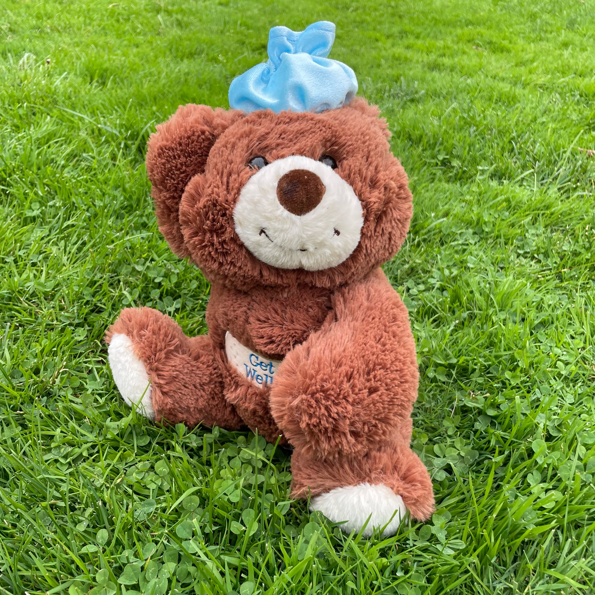

```text
A stuffed animal with shaggy brown fur, a white muzzle and paws, and a light blue cap sits upright in the grass with a “Get Well” message on its chest.
```

검토: □ 시각적 일치 □ 외형·동작·배경 범위 □ 관사·후치 수식 □ 불필요한 style 묘사 없음

메모:

## 004. dreambench/berry_bowl

- Identity: `bowl`
- 이미지: [02.jpg](../datasets/dreambench_uno/images/berry_bowl/02.jpg) (1280 × 1280)
- 상태: PASS

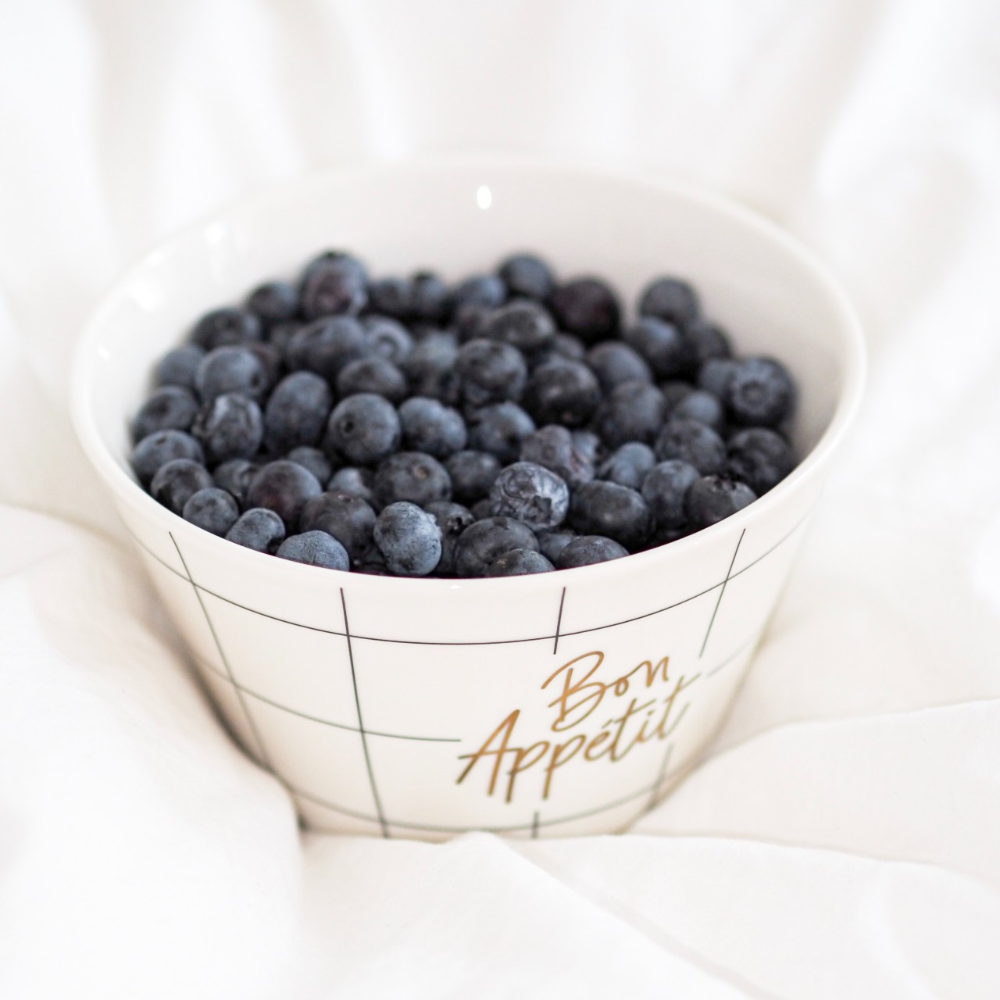

```text
a white bowl with thin grid lines and gold lettering filled with blueberries, resting on a white cloth
```

검토: □ 시각적 일치 □ 외형·동작·배경 범위 □ 관사·후치 수식 □ 불필요한 style 묘사 없음

메모:

## 005. dreambench/can

- Identity: `can`
- 이미지: [01.jpg](../datasets/dreambench_uno/images/can/01.jpg) (1280 × 1280)
- 상태: PASS

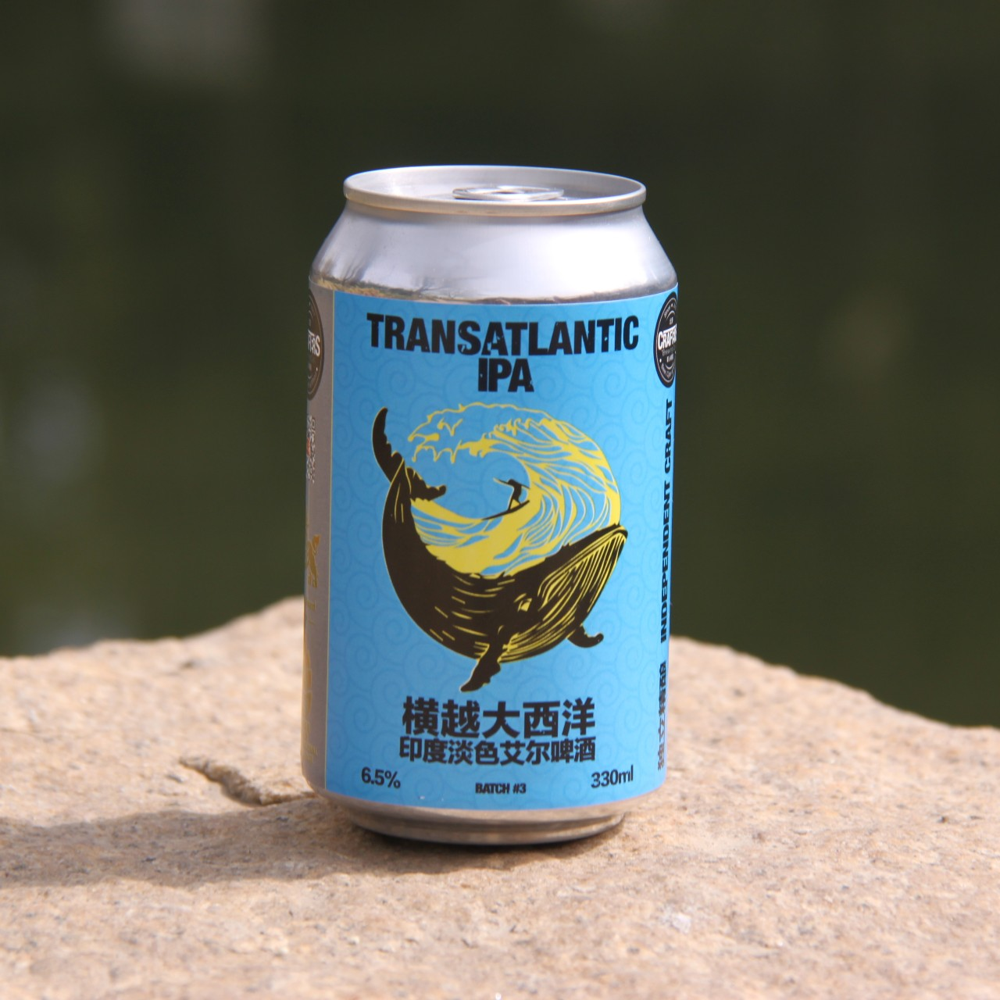

```text
a can with a silver body and bright blue label featuring a whale graphic, standing on a rough stone surface
```

검토: □ 시각적 일치 □ 외형·동작·배경 범위 □ 관사·후치 수식 □ 불필요한 style 묘사 없음

메모:

## 006. dreambench/candle

- Identity: `candle`
- 이미지: [02.jpg](../datasets/dreambench_uno/images/candle/02.jpg) (2048 × 2048)
- 상태: PASS

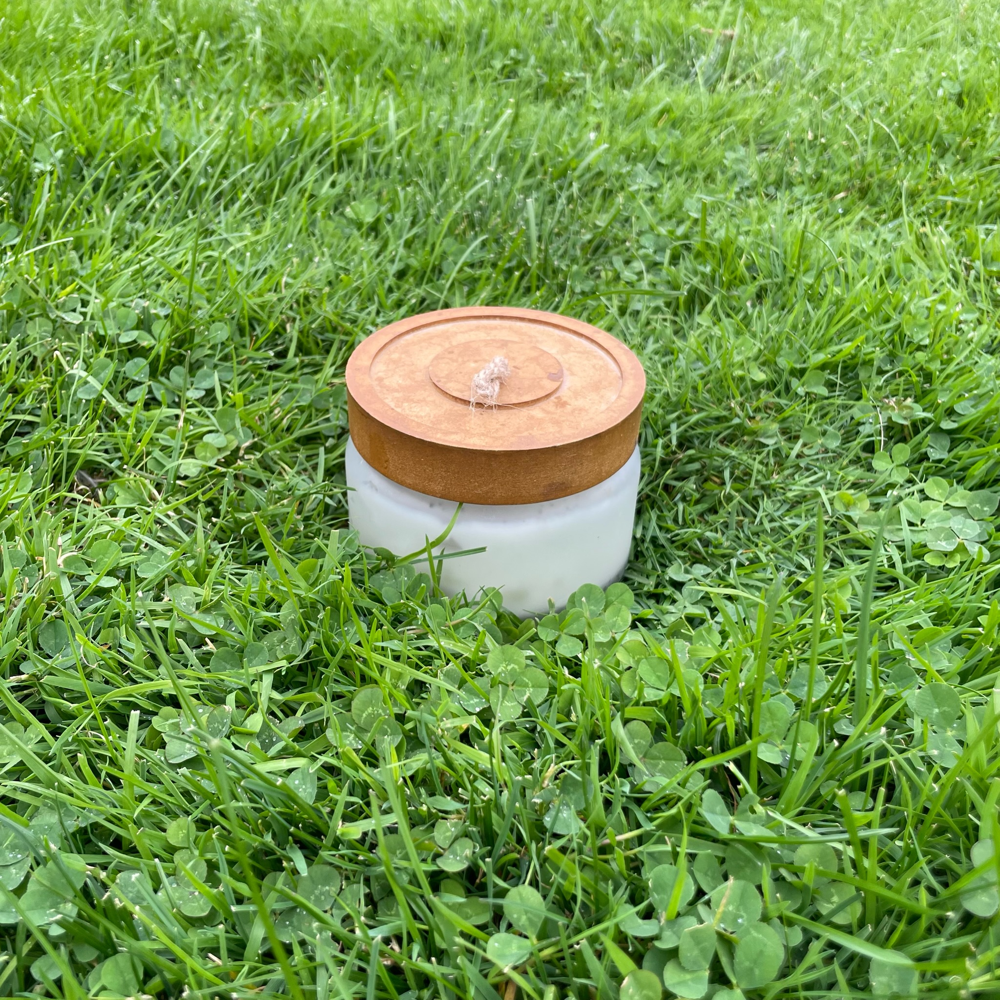

```text
A candle with white wax in a glass jar and a wide brown lid, with its wick exposed, sits in grass and clover.
```

검토: □ 시각적 일치 □ 외형·동작·배경 범위 □ 관사·후치 수식 □ 불필요한 style 묘사 없음

메모:

## 007. dreambench/cat

- Identity: `cat`
- 이미지: [04.jpg](../datasets/dreambench_uno/images/cat/04.jpg) (1282 × 1282)
- 상태: PASS

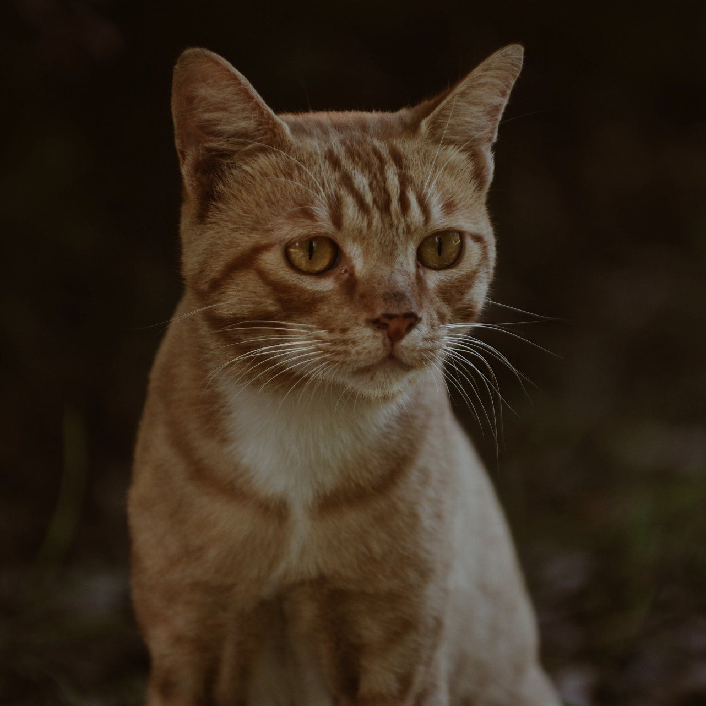

```text
A cat with orange tabby stripes and a white chest sits upright against a dark, indistinct background.
```

검토: □ 시각적 일치 □ 외형·동작·배경 범위 □ 관사·후치 수식 □ 불필요한 style 묘사 없음

메모:

## 008. dreambench/cat2

- Identity: `cat`
- 이미지: [02.jpg](../datasets/dreambench_uno/images/cat2/02.jpg) (1280 × 1280)
- 상태: PASS

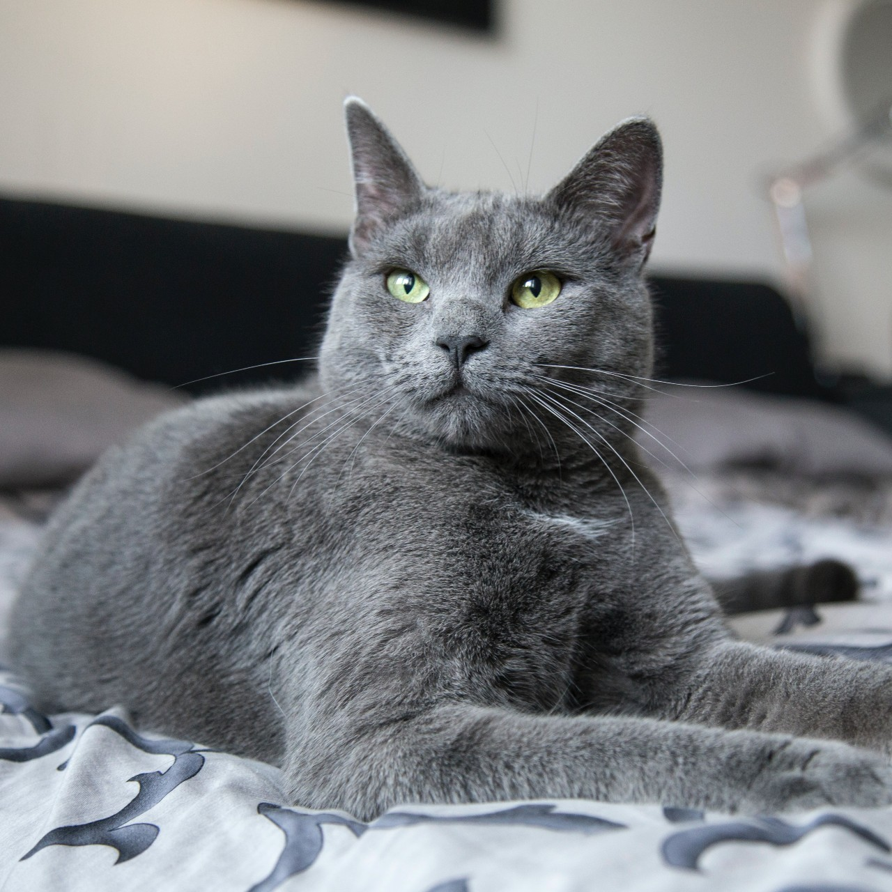

```text
A cat with short gray fur and green eyes reclining with its front legs stretched out on a patterned bed.
```

검토: □ 시각적 일치 □ 외형·동작·배경 범위 □ 관사·후치 수식 □ 불필요한 style 묘사 없음

메모:

## 009. dreambench/clock

- Identity: `clock`
- 이미지: [03.jpg](../datasets/dreambench_uno/images/clock/03.jpg) (1280 × 1280)
- 상태: PASS


```text
a clock with a bright yellow round casing, white face, and twin bells resting on rumpled white fabric
```

검토: □ 시각적 일치 □ 외형·동작·배경 범위 □ 관사·후치 수식 □ 불필요한 style 묘사 없음

메모:

## 010. dreambench/colorful_sneaker

- Identity: `sneaker`
- 이미지: [01.jpg](../datasets/dreambench_uno/images/colorful_sneaker/01.jpg) (2048 × 2048)
- 상태: PASS

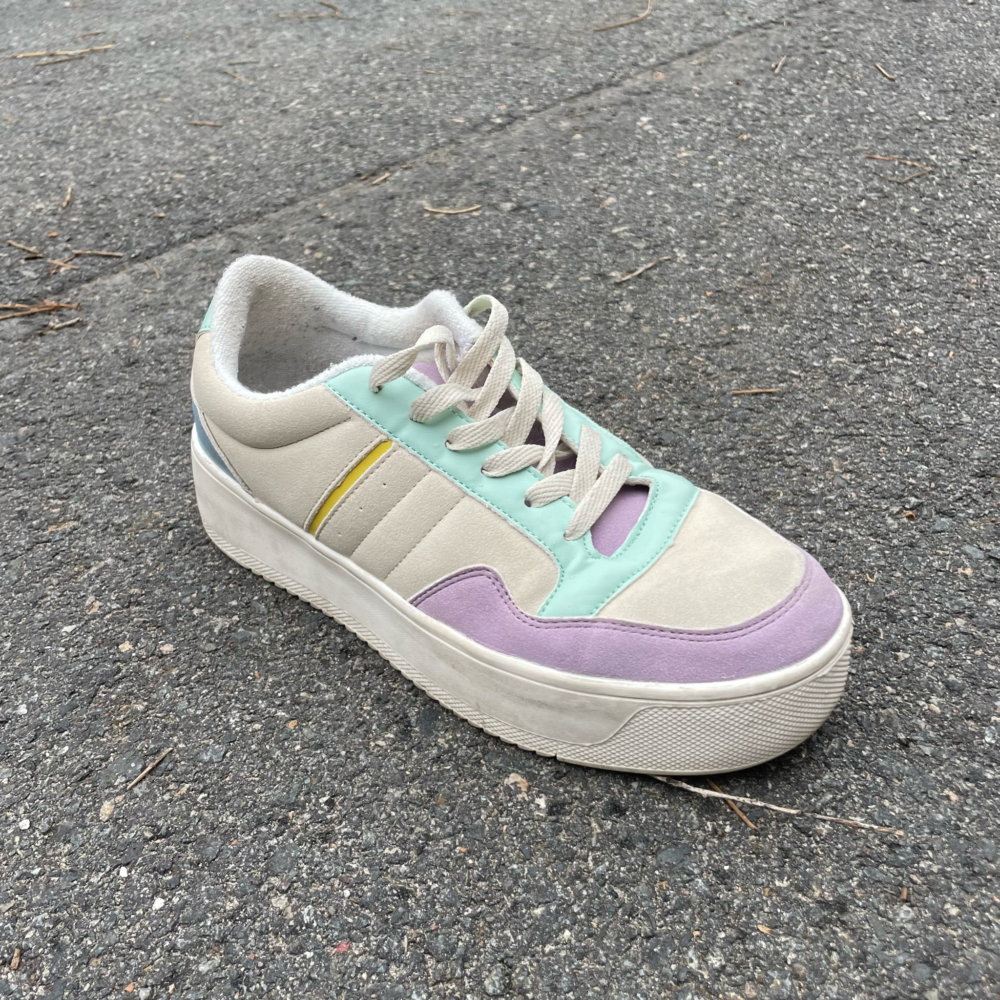

```text
A sneaker with an off-white body, mint-green panels, lavender accents, and white laces rests on rough asphalt.
```

검토: □ 시각적 일치 □ 외형·동작·배경 범위 □ 관사·후치 수식 □ 불필요한 style 묘사 없음

메모:

## 011. dreambench/dog

- Identity: `dog`
- 이미지: [02.jpg](../datasets/dreambench_uno/images/dog/02.jpg) (780 × 780)
- 상태: PASS

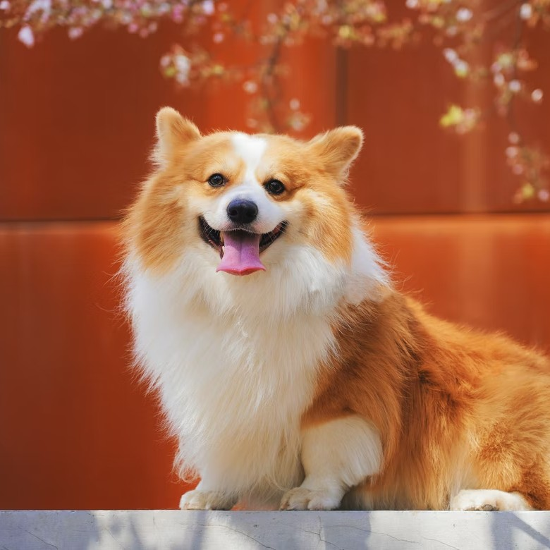

```text
a dog with fluffy golden and white fur sitting on a ledge with its tongue out in front of an orange wall
```

검토: □ 시각적 일치 □ 외형·동작·배경 범위 □ 관사·후치 수식 □ 불필요한 style 묘사 없음

메모:

## 012. dreambench/dog2

- Identity: `dog`
- 이미지: [02.jpg](../datasets/dreambench_uno/images/dog2/02.jpg) (1280 × 1280)
- 상태: PASS

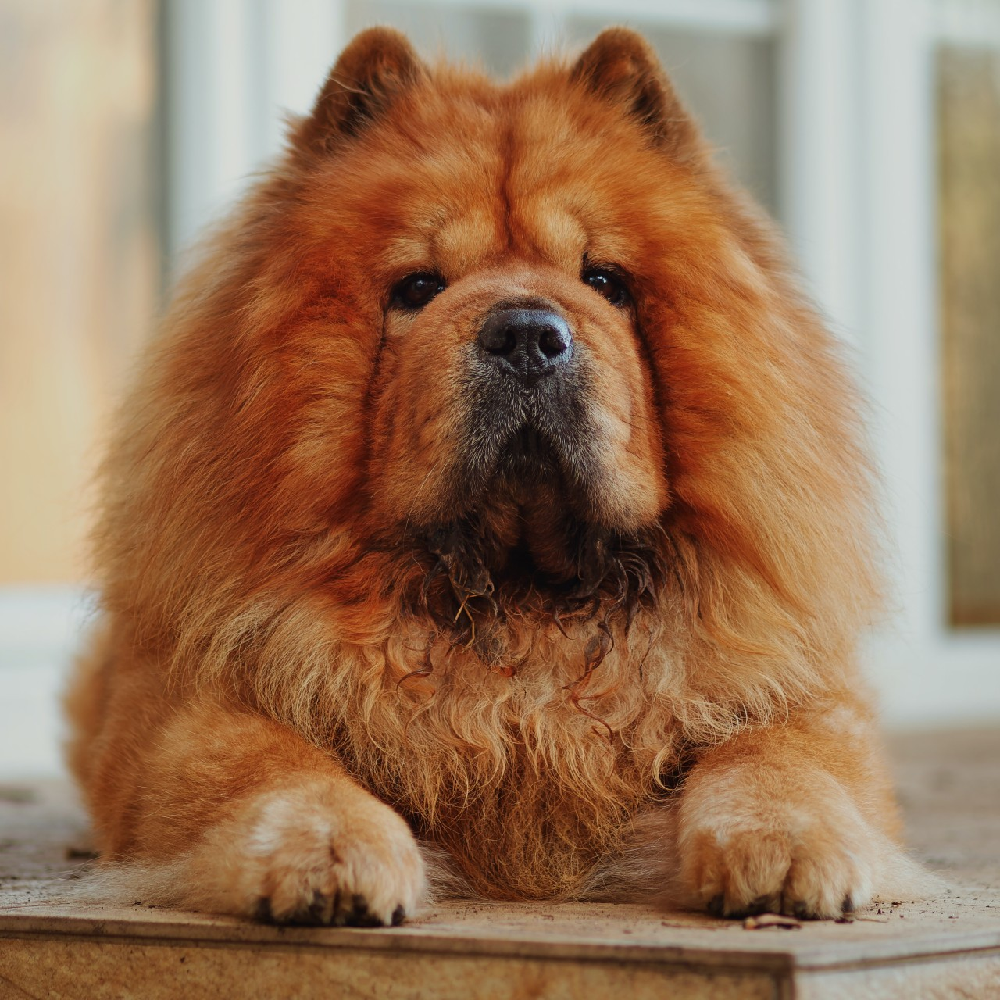

```text
a dog with thick reddish-brown fur and a dark muzzle lying with its front paws on a stone ledge
```

검토: □ 시각적 일치 □ 외형·동작·배경 범위 □ 관사·후치 수식 □ 불필요한 style 묘사 없음

메모:

## 013. dreambench/dog3

- Identity: `dog`
- 이미지: [05.jpg](../datasets/dreambench_uno/images/dog3/05.jpg) (820 × 820)
- 상태: PASS

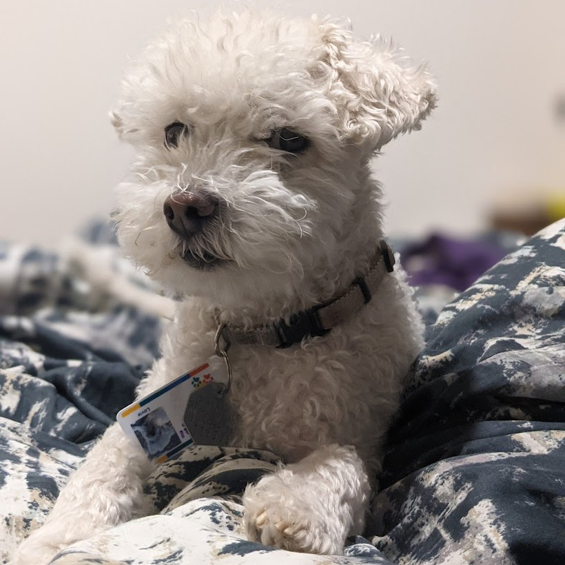

```text
a dog with curly white fur and a gray collar with dangling tags resting on a dark patterned blanket
```

검토: □ 시각적 일치 □ 외형·동작·배경 범위 □ 관사·후치 수식 □ 불필요한 style 묘사 없음

메모:

## 014. dreambench/dog5

- Identity: `dog`
- 이미지: [00.jpg](../datasets/dreambench_uno/images/dog5/00.jpg) (1440 × 1440)
- 상태: PASS

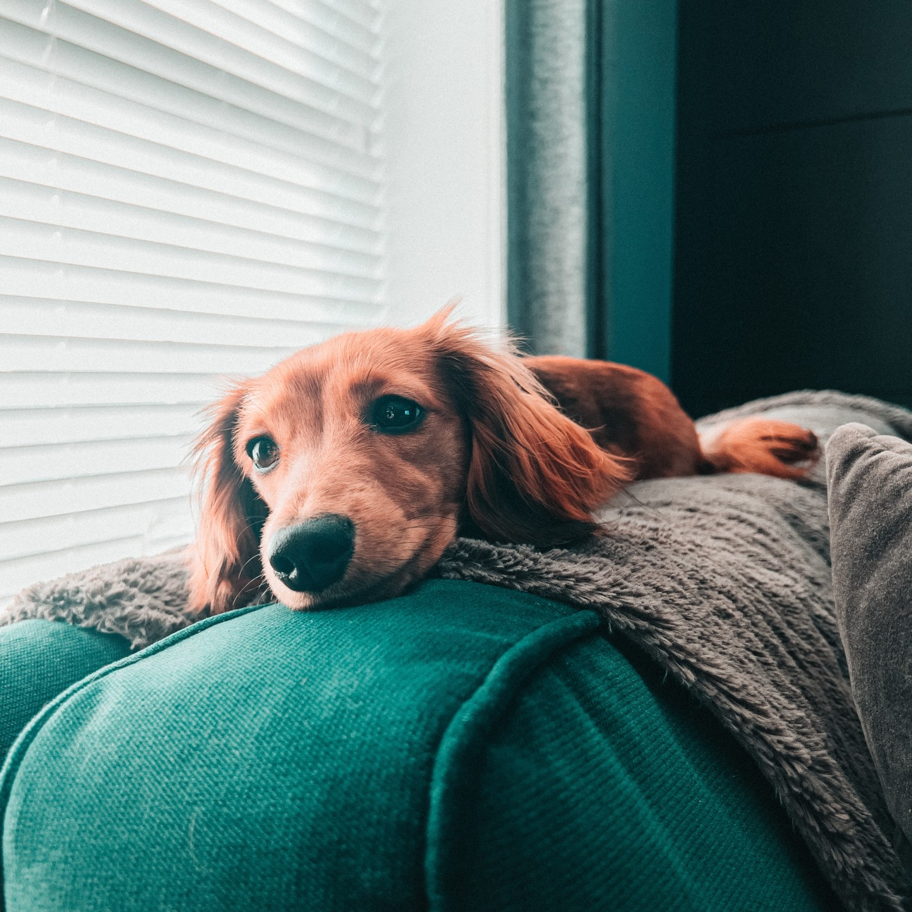

```text
a dog with reddish-brown fur and long floppy ears lying with its chin on a teal couch cushion beside a window
```

검토: □ 시각적 일치 □ 외형·동작·배경 범위 □ 관사·후치 수식 □ 불필요한 style 묘사 없음

메모:

## 015. dreambench/dog6

- Identity: `dog`
- 이미지: [02.jpg](../datasets/dreambench_uno/images/dog6/02.jpg) (1272 × 1272)
- 상태: PASS

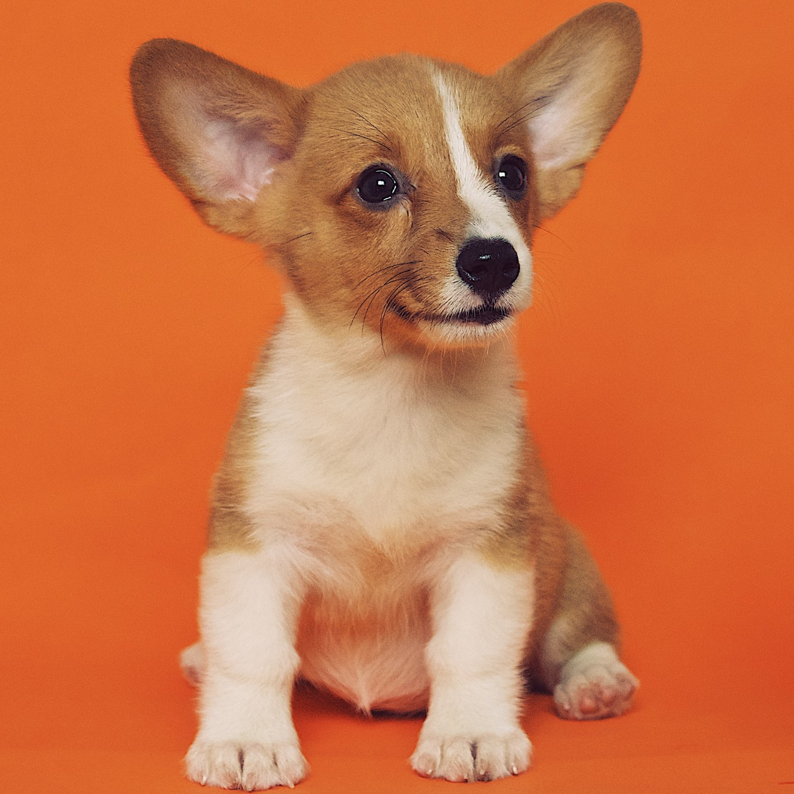

```text
a dog with tan and white fur and large upright ears sitting against an orange background
```

검토: □ 시각적 일치 □ 외형·동작·배경 범위 □ 관사·후치 수식 □ 불필요한 style 묘사 없음

메모:

## 016. dreambench/dog7

- Identity: `dog`
- 이미지: [01.jpg](../datasets/dreambench_uno/images/dog7/01.jpg) (1195 × 1195)
- 상태: PASS

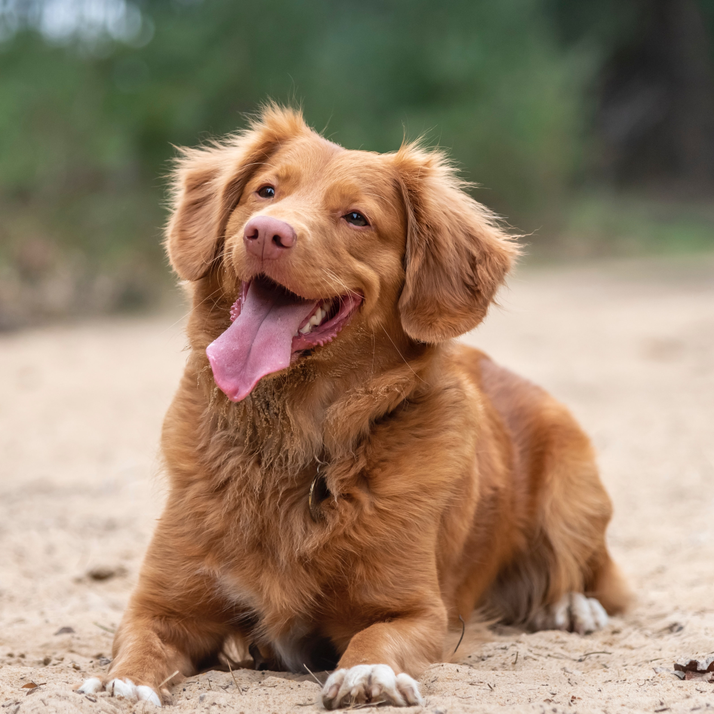

```text
a dog with shaggy reddish-brown fur and white paws lying on sandy ground with its mouth open and tongue out
```

검토: □ 시각적 일치 □ 외형·동작·배경 범위 □ 관사·후치 수식 □ 불필요한 style 묘사 없음

메모:

## 017. dreambench/dog8

- Identity: `dog`
- 이미지: [04.jpg](../datasets/dreambench_uno/images/dog8/04.jpg) (1280 × 1280)
- 상태: PASS

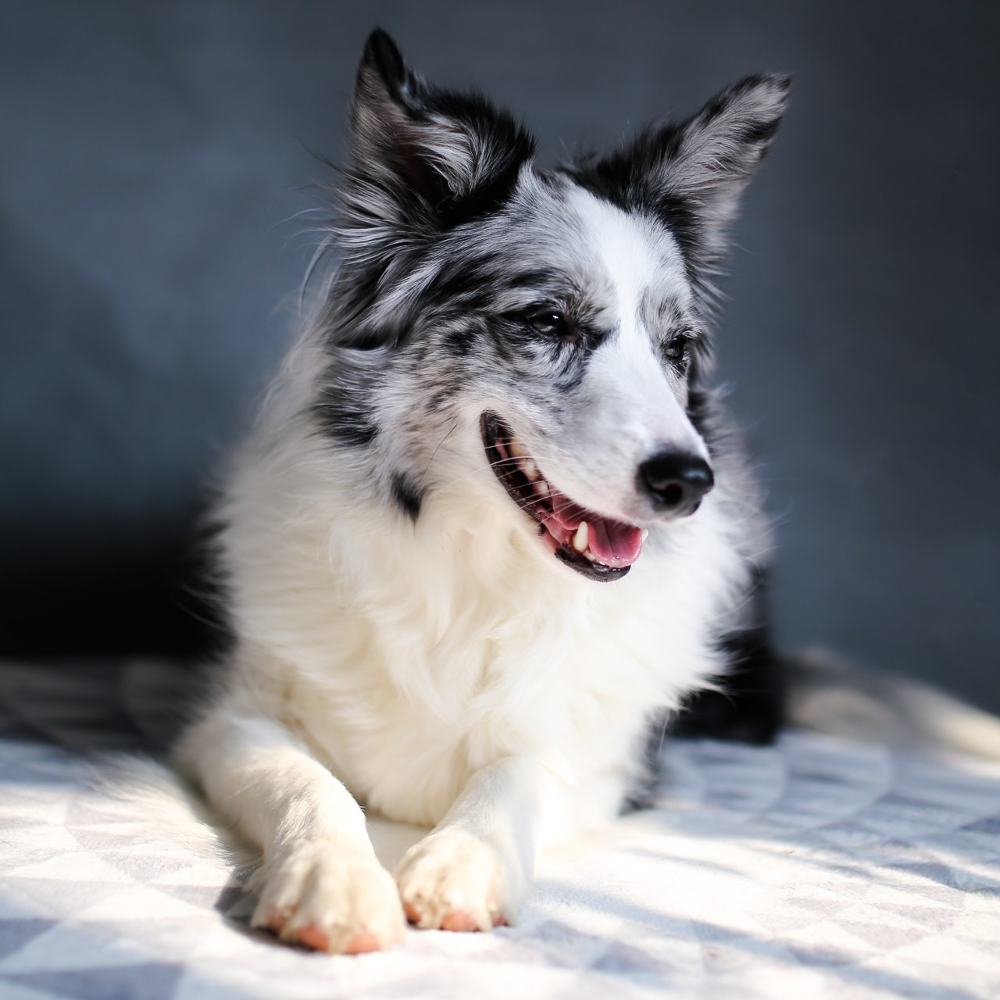

```text
a dog with fluffy white fur and black mottled markings lying with its front paws forward on a patterned blanket, its mouth open and ears upright
```

검토: □ 시각적 일치 □ 외형·동작·배경 범위 □ 관사·후치 수식 □ 불필요한 style 묘사 없음

메모:

## 018. dreambench/duck_toy

- Identity: `toy`
- 이미지: [01.jpg](../datasets/dreambench_uno/images/duck_toy/01.jpg) (1440 × 1440)
- 상태: PASS

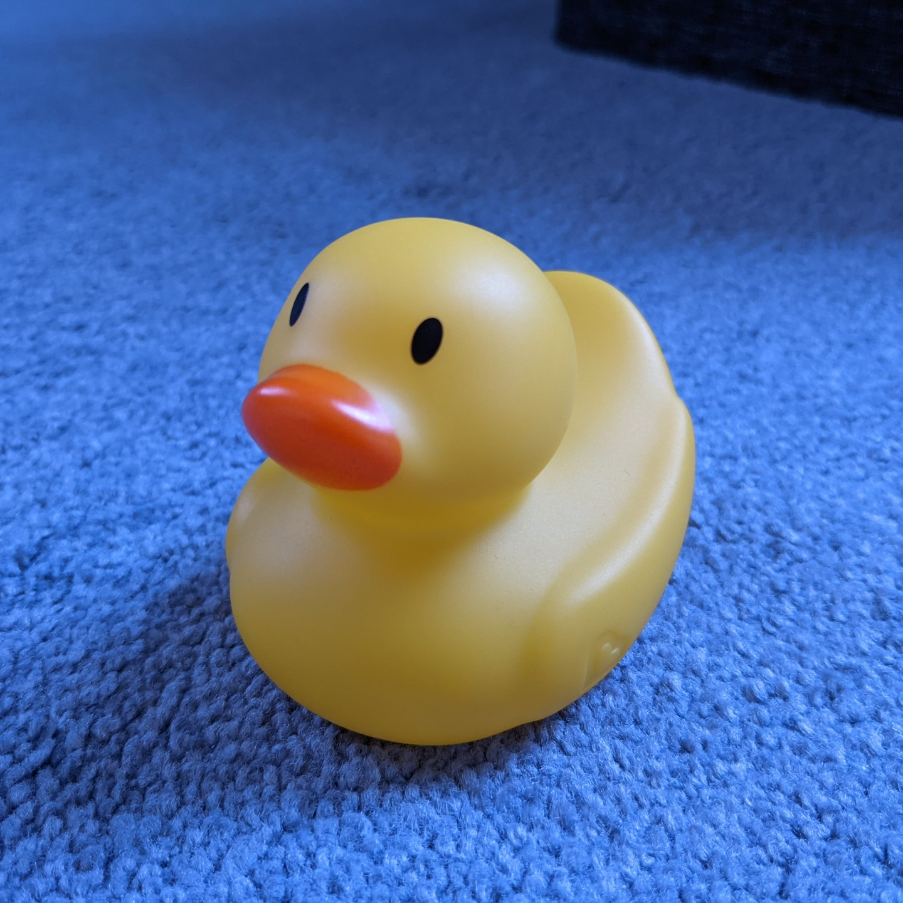

```text
a toy shaped like a yellow duck with an orange bill and black eyes resting on blue fabric
```

검토: □ 시각적 일치 □ 외형·동작·배경 범위 □ 관사·후치 수식 □ 불필요한 style 묘사 없음

메모:

## 019. dreambench/fancy_boot

- Identity: `boot`
- 이미지: [02.jpg](../datasets/dreambench_uno/images/fancy_boot/02.jpg) (2048 × 2048)
- 상태: PASS

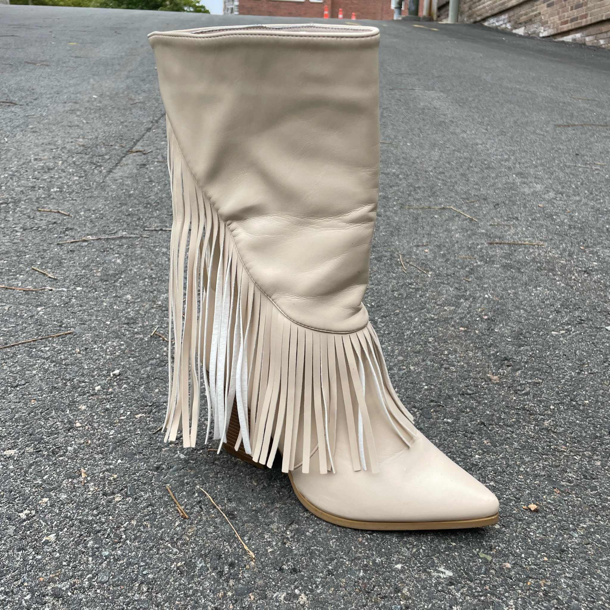

```text
a boot with a pale beige shaft, long fringe, and a pointed toe standing on an asphalt street
```

검토: □ 시각적 일치 □ 외형·동작·배경 범위 □ 관사·후치 수식 □ 불필요한 style 묘사 없음

메모:

## 020. dreambench/grey_sloth_plushie

- Identity: `stuffed animal`
- 이미지: [04.jpg](../datasets/dreambench_uno/images/grey_sloth_plushie/04.jpg) (2048 × 2048)
- 상태: PASS

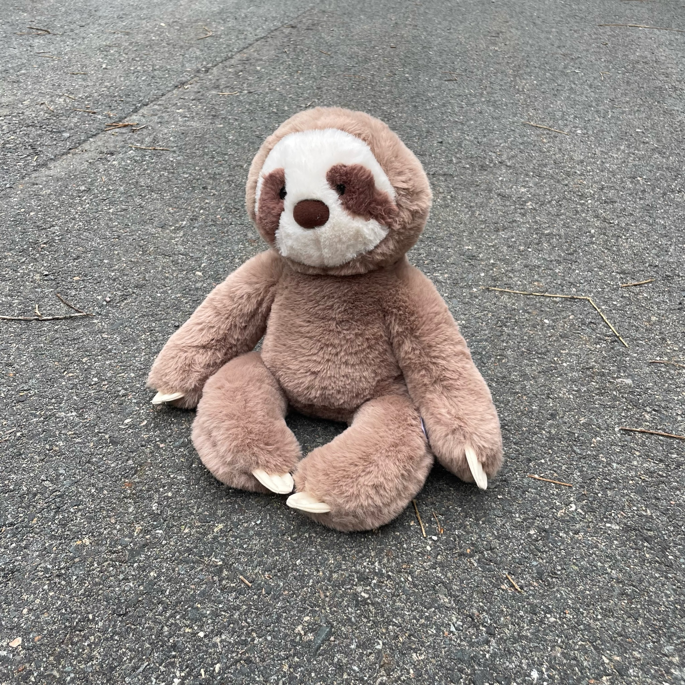

```text
A stuffed animal with shaggy brown fur, a white face, and dark brown patches sits on rough pavement.
```

검토: □ 시각적 일치 □ 외형·동작·배경 범위 □ 관사·후치 수식 □ 불필요한 style 묘사 없음

메모:

## 021. dreambench/monster_toy

- Identity: `toy`
- 이미지: [04.jpg](../datasets/dreambench_uno/images/monster_toy/04.jpg) (1440 × 1440)
- 상태: PASS

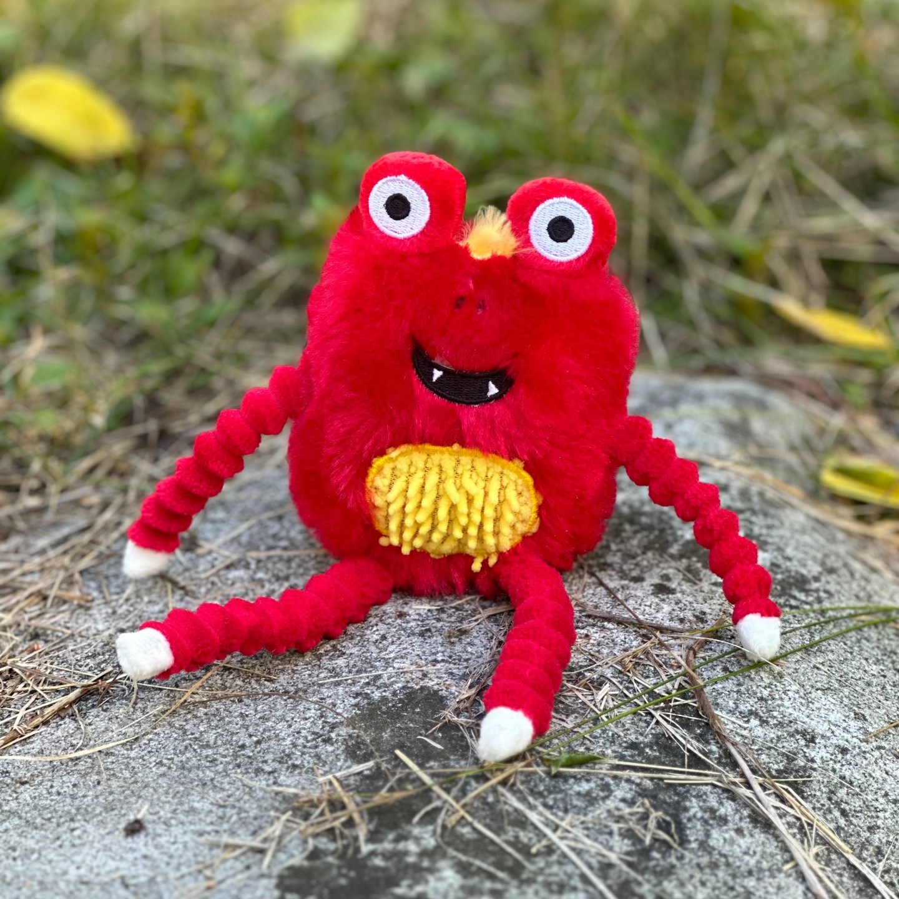

```text
a toy with a fuzzy red body, large round eyes, a yellow belly, and long limbs sitting on a stone surface among dry grass
```

검토: □ 시각적 일치 □ 외형·동작·배경 범위 □ 관사·후치 수식 □ 불필요한 style 묘사 없음

메모:

## 022. dreambench/pink_sunglasses

- Identity: `glasses`
- 이미지: [04.jpg](../datasets/dreambench_uno/images/pink_sunglasses/04.jpg) (1545 × 1545)
- 상태: PASS

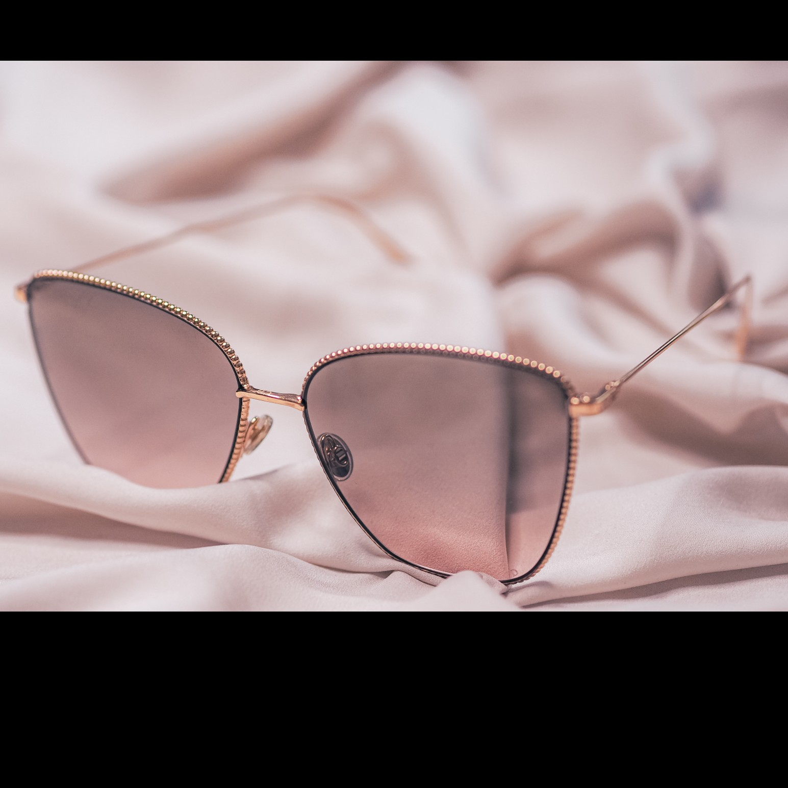

```text
glasses with oversized pink-tinted lenses and gold frames edged with small beads resting on draped pale fabric
```

검토: □ 시각적 일치 □ 외형·동작·배경 범위 □ 관사·후치 수식 □ 불필요한 style 묘사 없음

메모:

## 023. dreambench/poop_emoji

- Identity: `toy`
- 이미지: [00.jpg](../datasets/dreambench_uno/images/poop_emoji/00.jpg) (2048 × 2048)
- 상태: PASS

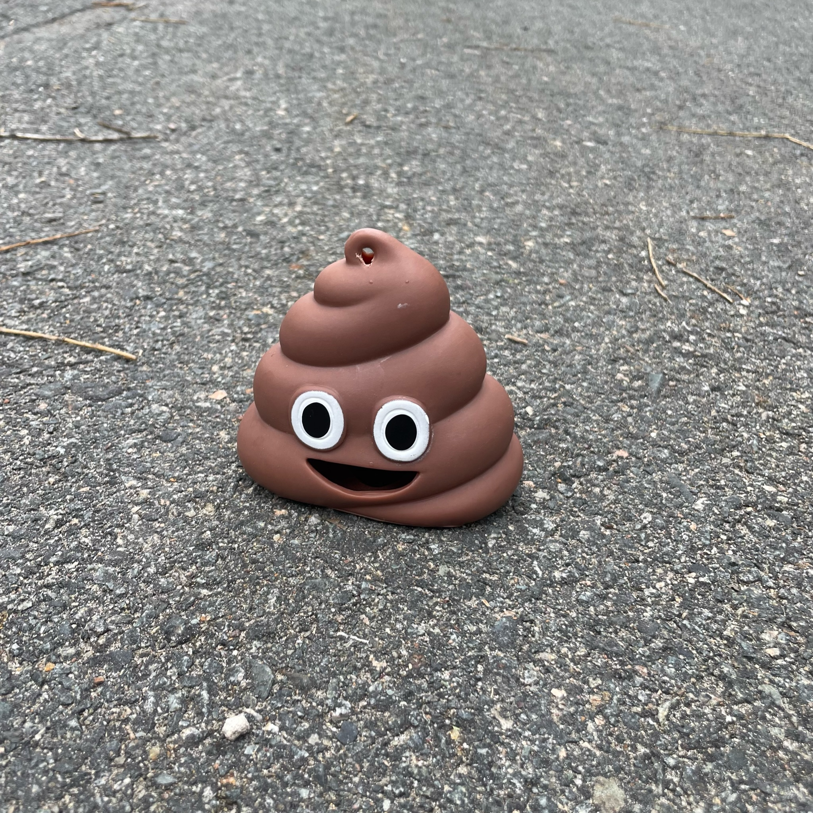

```text
A toy shaped like a brown swirl with large white-and-black eyes and an open mouth sits on rough pavement.
```

검토: □ 시각적 일치 □ 외형·동작·배경 범위 □ 관사·후치 수식 □ 불필요한 style 묘사 없음

메모:

## 024. dreambench/rc_car

- Identity: `toy`
- 이미지: [03.jpg](../datasets/dreambench_uno/images/rc_car/03.jpg) (1440 × 1440)
- 상태: PASS

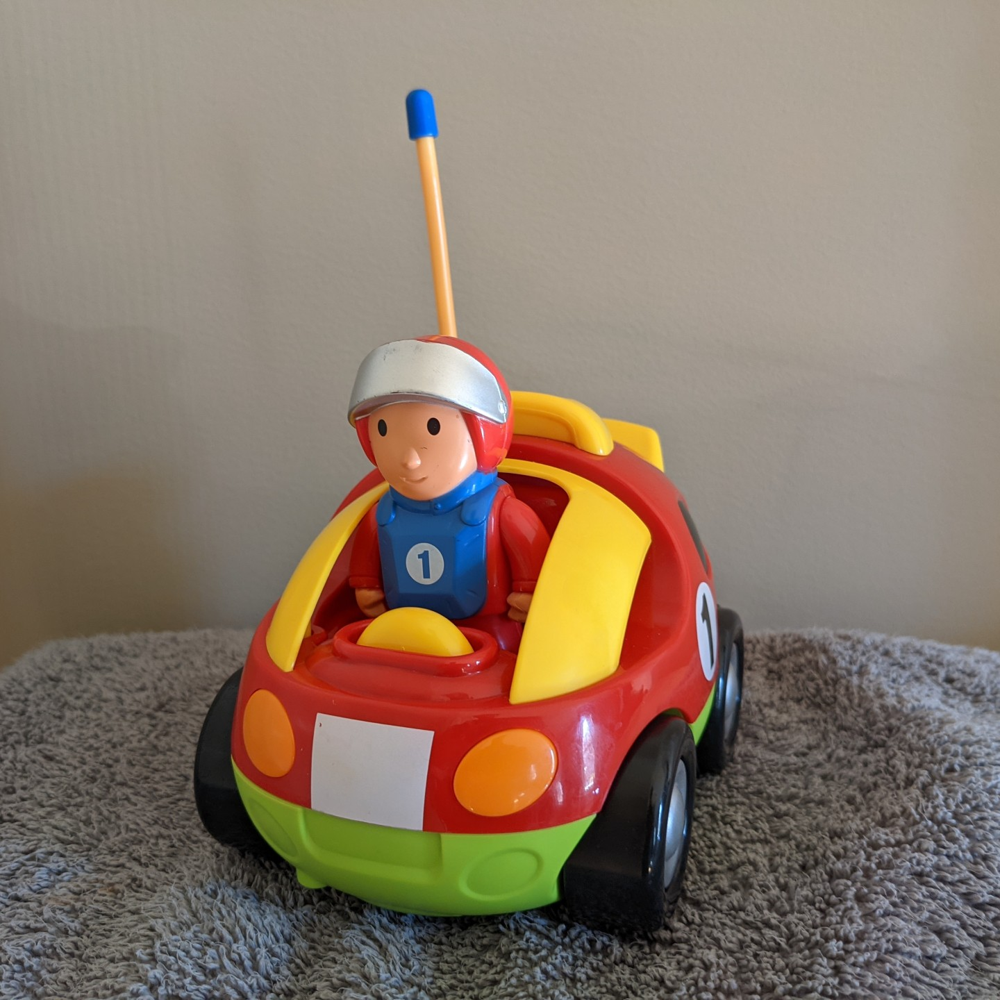

```text
A toy consisting of a red and green race car with yellow trim and a helmeted figure seated inside rests on a carpet.
```

검토: □ 시각적 일치 □ 외형·동작·배경 범위 □ 관사·후치 수식 □ 불필요한 style 묘사 없음

메모:

## 025. dreambench/red_cartoon

- Identity: `cartoon`
- 이미지: [00.jpg](../datasets/dreambench_uno/images/red_cartoon/00.jpg) (2048 × 2048)
- 상태: PASS

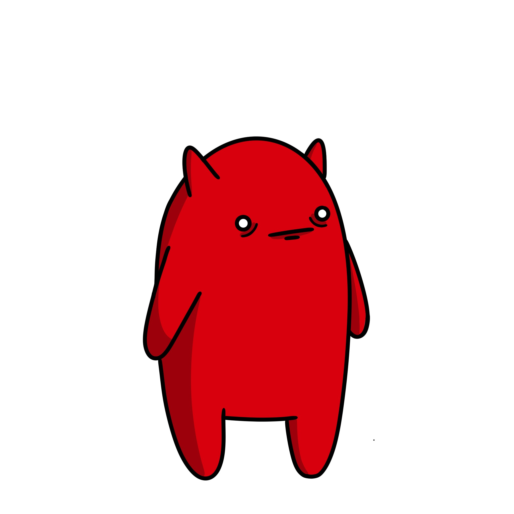

```text
a red cartoon creature with small pointed horns and a rounded body standing with one arm raised against a white background
```

검토: □ 시각적 일치 □ 외형·동작·배경 범위 □ 관사·후치 수식 □ 불필요한 style 묘사 없음

메모:

## 026. dreambench/robot_toy

- Identity: `toy`
- 이미지: [00.jpg](../datasets/dreambench_uno/images/robot_toy/00.jpg) (1440 × 1440)
- 상태: PASS

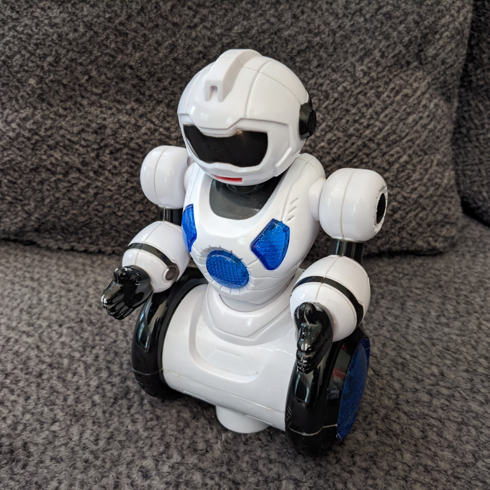

```text
A toy with a glossy white body, blue panels, and a black visor sits upright on a gray textured surface.
```

검토: □ 시각적 일치 □ 외형·동작·배경 범위 □ 관사·후치 수식 □ 불필요한 style 묘사 없음

메모:

## 027. dreambench/shiny_sneaker

- Identity: `sneaker`
- 이미지: [01.jpg](../datasets/dreambench_uno/images/shiny_sneaker/01.jpg) (2048 × 2048)
- 상태: PASS

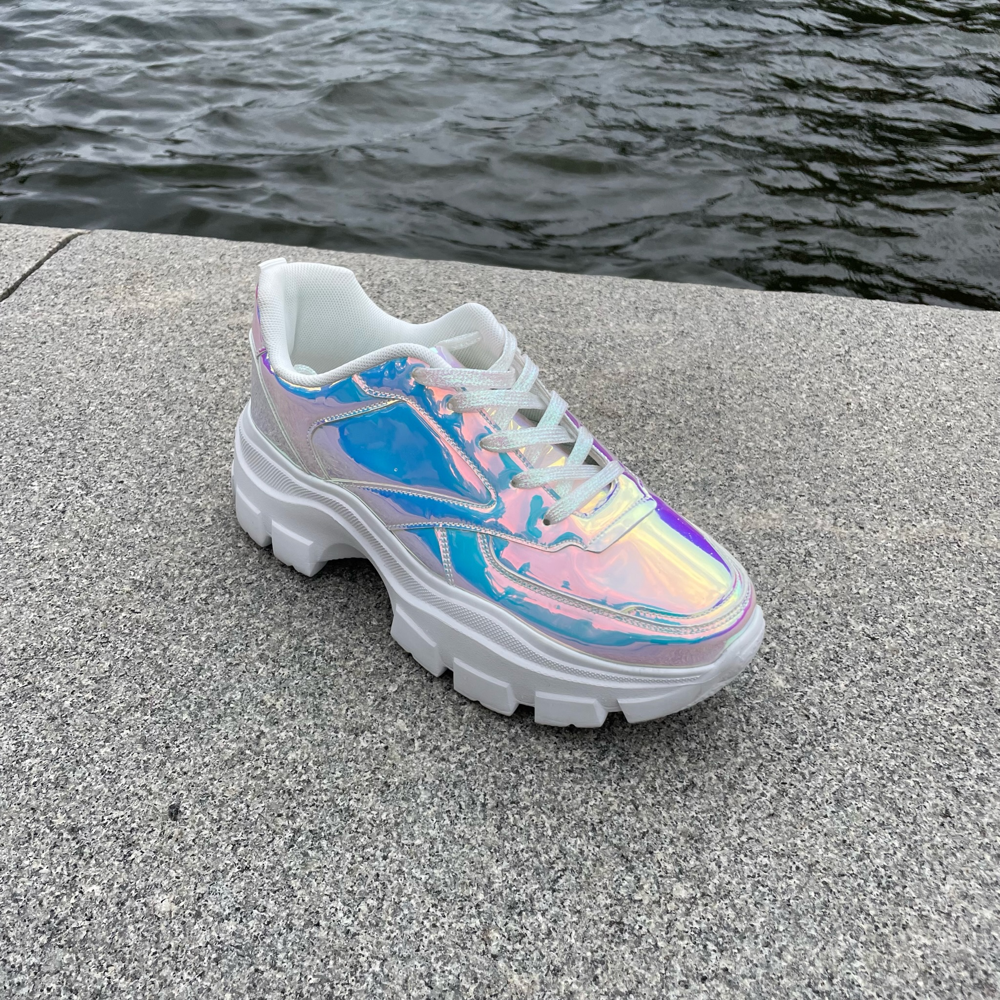

```text
A sneaker with iridescent blue, pink, and yellow panels, white laces, and a chunky sole rests on a stone ledge beside rippling water.
```

검토: □ 시각적 일치 □ 외형·동작·배경 범위 □ 관사·후치 수식 □ 불필요한 style 묘사 없음

메모:

## 028. dreambench/teapot

- Identity: `teapot`
- 이미지: [04.jpg](../datasets/dreambench_uno/images/teapot/04.jpg) (1073 × 1073)
- 상태: PASS

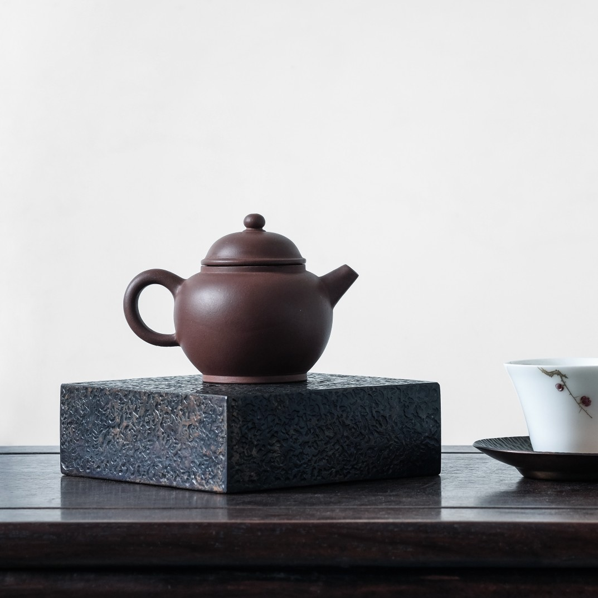

```text
A dark brown teapot with a rounded body and domed lid sits on a textured black block atop a dark wooden table.
```

검토: □ 시각적 일치 □ 외형·동작·배경 범위 □ 관사·후치 수식 □ 불필요한 style 묘사 없음

메모:

## 029. dreambench/vase

- Identity: `vase`
- 이미지: [02.jpg](../datasets/dreambench_uno/images/vase/02.jpg) (1044 × 1044)
- 상태: PASS

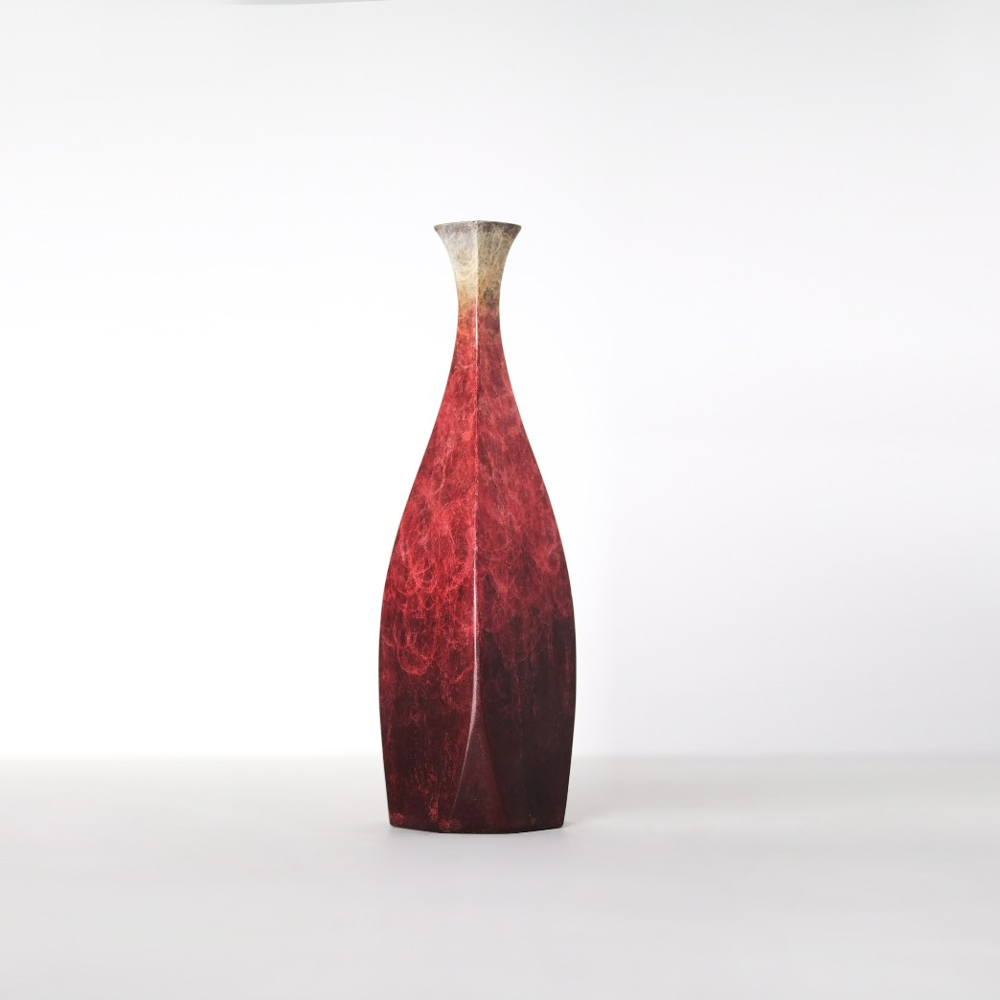

```text
A vase with a tall, narrow neck, a flared rim, and a faceted deep red body with a pale tan top stands on a white surface.
```

검토: □ 시각적 일치 □ 외형·동작·배경 범위 □ 관사·후치 수식 □ 불필요한 style 묘사 없음

메모:

## 030. dreambench/wolf_plushie

- Identity: `stuffed animal`
- 이미지: [04.jpg](../datasets/dreambench_uno/images/wolf_plushie/04.jpg) (2048 × 2048)
- 상태: PASS

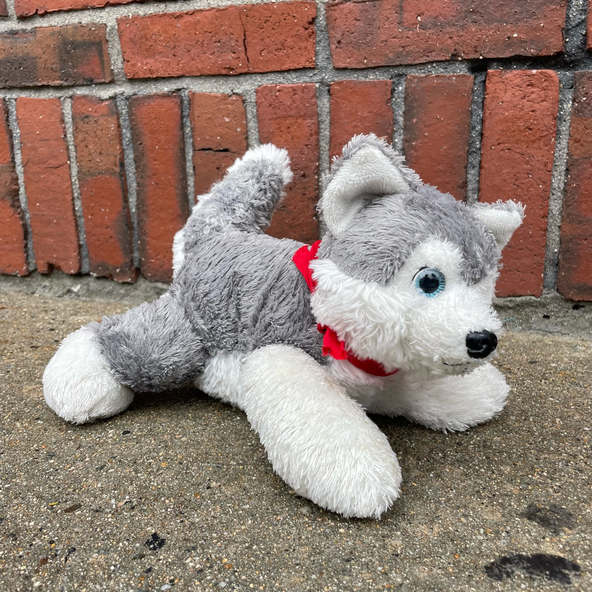

```text
a stuffed animal with shaggy gray and white fur, blue eyes, and a red collar lying on a concrete surface against a brick wall
```

검토: □ 시각적 일치 □ 외형·동작·배경 범위 □ 관사·후치 수식 □ 불필요한 style 묘사 없음

메모:

## 031. dreambench_plus/live_subject/animal/00

- Identity: `kitten`
- 이미지: [00.jpg](../datasets/XVerseBench/dreambench_plus_raw/extracted/data/images/live_subject/animal/00.jpg) (1024 × 1024)
- 상태: PASS


```text
a kitten with fluffy gray-and-white fur sitting upright on a bed among patterned pillows
```

검토: □ 시각적 일치 □ 외형·동작·배경 범위 □ 관사·후치 수식 □ 불필요한 style 묘사 없음

메모:

## 032. dreambench_plus/live_subject/animal/01

- Identity: `stork`
- 이미지: [01.jpg](../datasets/XVerseBench/dreambench_plus_raw/extracted/data/images/live_subject/animal/01.jpg) (1024 × 1024)
- 상태: PASS


```text
a stork with white plumage, dark wing feathers, and a long red beak standing on a tiled rooftop
```

검토: □ 시각적 일치 □ 외형·동작·배경 범위 □ 관사·후치 수식 □ 불필요한 style 묘사 없음

메모:

## 033. dreambench_plus/live_subject/animal/02

- Identity: `kitten`
- 이미지: [02.jpg](../datasets/XVerseBench/dreambench_plus_raw/extracted/data/images/live_subject/animal/02.jpg) (1024 × 1024)
- 상태: PASS


```text
a kitten with fluffy brown-and-gray striped fur sitting on a gray tiled floor
```

검토: □ 시각적 일치 □ 외형·동작·배경 범위 □ 관사·후치 수식 □ 불필요한 style 묘사 없음

메모:

## 034. dreambench_plus/live_subject/animal/03

- Identity: `horse`
- 이미지: [03.jpg](../datasets/XVerseBench/dreambench_plus_raw/extracted/data/images/live_subject/animal/03.jpg) (1024 × 1024)
- 상태: PASS


```text
a horse with a chestnut coat, a long pale mane, and a broad white blaze standing against an open sky
```

검토: □ 시각적 일치 □ 외형·동작·배경 범위 □ 관사·후치 수식 □ 불필요한 style 묘사 없음

메모:

## 035. dreambench_plus/live_subject/animal/04

- Identity: `crab`
- 이미지: [04.jpg](../datasets/XVerseBench/dreambench_plus_raw/extracted/data/images/live_subject/animal/04.jpg) (1024 × 1024)
- 상태: PASS


```text
a crab with a dark, striped shell and orange legs standing on sandy ground
```

검토: □ 시각적 일치 □ 외형·동작·배경 범위 □ 관사·후치 수식 □ 불필요한 style 묘사 없음

메모:

## 036. dreambench_plus/live_subject/animal/05

- Identity: `penguin`
- 이미지: [05.jpg](../datasets/XVerseBench/dreambench_plus_raw/extracted/data/images/live_subject/animal/05.jpg) (1024 × 1024)
- 상태: PASS


```text
a penguin with a black head and white body standing on snow with its flippers held out
```

검토: □ 시각적 일치 □ 외형·동작·배경 범위 □ 관사·후치 수식 □ 불필요한 style 묘사 없음

메모:

## 037. dreambench_plus/live_subject/animal/06

- Identity: `shark`
- 이미지: [06.jpg](../datasets/XVerseBench/dreambench_plus_raw/extracted/data/images/live_subject/animal/06.jpg) (1024 × 1024)
- 상태: PASS


```text
a shark with a dark gray back and pale underside swimming above a sandy seabed
```

검토: □ 시각적 일치 □ 외형·동작·배경 범위 □ 관사·후치 수식 □ 불필요한 style 묘사 없음

메모:

## 038. dreambench_plus/live_subject/animal/07

- Identity: `dog`
- 이미지: [07.jpg](../datasets/XVerseBench/dreambench_plus_raw/extracted/data/images/live_subject/animal/07.jpg) (1024 × 1024)
- 상태: PASS


```text
a dog with reddish-brown fur and a white chest standing in shallow surf at the pebbled shoreline with its tongue out
```

검토: □ 시각적 일치 □ 외형·동작·배경 범위 □ 관사·후치 수식 □ 불필요한 style 묘사 없음

메모:

## 039. dreambench_plus/live_subject/animal/08

- Identity: `raccoon`
- 이미지: [08.jpg](../datasets/XVerseBench/dreambench_plus_raw/extracted/data/images/live_subject/animal/08.jpg) (1024 × 1024)
- 상태: PASS


```text
a raccoon with fluffy brown-gray fur and a dark mask across its eyes crouching in green grass with one paw raised
```

검토: □ 시각적 일치 □ 외형·동작·배경 범위 □ 관사·후치 수식 □ 불필요한 style 묘사 없음

메모:

## 040. dreambench_plus/live_subject/animal/09

- Identity: `rooster`
- 이미지: [09.jpg](../datasets/XVerseBench/dreambench_plus_raw/extracted/data/images/live_subject/animal/09.jpg) (1024 × 1024)
- 상태: PASS


```text
a rooster with a red comb, creamy white neck feathers, orange back, and iridescent black tail walking across dirt
```

검토: □ 시각적 일치 □ 외형·동작·배경 범위 □ 관사·후치 수식 □ 불필요한 style 묘사 없음

메모:

## 041. dreambench_plus/live_subject/animal/10

- Identity: `fox`
- 이미지: [10.jpg](../datasets/XVerseBench/dreambench_plus_raw/extracted/data/images/live_subject/animal/10.jpg) (1024 × 1024)
- 상태: PASS


```text
a fox with orange-red fur, a pale chest, and dark legs standing on a snowy surface
```

검토: □ 시각적 일치 □ 외형·동작·배경 범위 □ 관사·후치 수식 □ 불필요한 style 묘사 없음

메모:

## 042. dreambench_plus/live_subject/animal/11

- Identity: `heron`
- 이미지: [11.jpg](../datasets/XVerseBench/dreambench_plus_raw/extracted/data/images/live_subject/animal/11.jpg) (1024 × 1024)
- 상태: PASS


```text
a heron with gray and white feathers and a long orange bill flying with its wings spread against a blurred background
```

검토: □ 시각적 일치 □ 외형·동작·배경 범위 □ 관사·후치 수식 □ 불필요한 style 묘사 없음

메모:

## 043. dreambench_plus/live_subject/animal/12

- Identity: `dog`
- 이미지: [12.jpg](../datasets/XVerseBench/dreambench_plus_raw/extracted/data/images/live_subject/animal/12.jpg) (1024 × 1024)
- 상태: PASS


```text
a dog with white and brown fur and long, floppy ears wearing a pink hoodie, crouched beside a white plush toy on a white floor
```

검토: □ 시각적 일치 □ 외형·동작·배경 범위 □ 관사·후치 수식 □ 불필요한 style 묘사 없음

메모:

## 044. dreambench_plus/live_subject/animal/13

- Identity: `polar bear`
- 이미지: [13.jpg](../datasets/XVerseBench/dreambench_plus_raw/extracted/data/images/live_subject/animal/13.jpg) (1024 × 1024)
- 상태: PASS


```text
a polar bear with creamy white fur standing upright on snowy ice with one paw raised
```

검토: □ 시각적 일치 □ 외형·동작·배경 범위 □ 관사·후치 수식 □ 불필요한 style 묘사 없음

메모:

## 045. dreambench_plus/live_subject/animal/14

- Identity: `eagle`
- 이미지: [14.jpg](../datasets/XVerseBench/dreambench_plus_raw/extracted/data/images/live_subject/animal/14.jpg) (1024 × 1024)
- 상태: PASS


```text
an eagle with dark brown feathers, a white head and tail, and a yellow beak gliding with its wings spread against a pale blue sky
```

검토: □ 시각적 일치 □ 외형·동작·배경 범위 □ 관사·후치 수식 □ 불필요한 style 묘사 없음

메모:

## 046. dreambench_plus/live_subject/animal/15

- Identity: `butterfly`
- 이미지: [15.jpg](../datasets/XVerseBench/dreambench_plus_raw/extracted/data/images/live_subject/animal/15.jpg) (1024 × 1024)
- 상태: PASS


```text
a butterfly with orange-yellow wings, dark veins, and white spots spread flat against a pale gray background
```

검토: □ 시각적 일치 □ 외형·동작·배경 범위 □ 관사·후치 수식 □ 불필요한 style 묘사 없음

메모:

## 047. dreambench_plus/live_subject/animal/16

- Identity: `jellyfish`
- 이미지: [16.jpg](../datasets/XVerseBench/dreambench_plus_raw/extracted/data/images/live_subject/animal/16.jpg) (1024 × 1024)
- 상태: PASS


```text
a jellyfish with a bright yellow bell and long translucent purple tentacles floating in dark water
```

검토: □ 시각적 일치 □ 외형·동작·배경 범위 □ 관사·후치 수식 □ 불필요한 style 묘사 없음

메모:

## 048. dreambench_plus/live_subject/animal/17

- Identity: `frog`
- 이미지: [17.jpg](../datasets/XVerseBench/dreambench_plus_raw/extracted/data/images/live_subject/animal/17.jpg) (1024 × 1024)
- 상태: PASS


```text
a frog with a bright orange body, black speckles, and deep blue legs crouching on a rough rock
```

검토: □ 시각적 일치 □ 외형·동작·배경 범위 □ 관사·후치 수식 □ 불필요한 style 묘사 없음

메모:

## 049. dreambench_plus/live_subject/animal/18

- Identity: `sea turtle`
- 이미지: [18.jpg](../datasets/XVerseBench/dreambench_plus_raw/extracted/data/images/live_subject/animal/18.jpg) (1024 × 1024)
- 상태: PASS


```text
a sea turtle with a reddish-brown shell and patterned flippers swimming through blue water
```

검토: □ 시각적 일치 □ 외형·동작·배경 범위 □ 관사·후치 수식 □ 불필요한 style 묘사 없음

메모:

## 050. dreambench_plus/live_subject/animal/19

- Identity: `robin`
- 이미지: [19.jpg](../datasets/XVerseBench/dreambench_plus_raw/extracted/data/images/live_subject/animal/19.jpg) (1024 × 1024)
- 상태: PASS


```text
a robin with an orange breast and gray-brown feathers standing on a tree stump scattered with seeds
```

검토: □ 시각적 일치 □ 외형·동작·배경 범위 □ 관사·후치 수식 □ 불필요한 style 묘사 없음

메모:

## 051. dreambench_plus/live_subject/animal/20

- Identity: `hamster`
- 이미지: [20.jpg](../datasets/XVerseBench/dreambench_plus_raw/extracted/data/images/live_subject/animal/20.jpg) (1024 × 1024)
- 상태: PASS


```text
a hamster with fluffy golden-brown and white fur standing on a light-colored floor with its front paws held together beneath its nose
```

검토: □ 시각적 일치 □ 외형·동작·배경 범위 □ 관사·후치 수식 □ 불필요한 style 묘사 없음

메모:

## 052. dreambench_plus/live_subject/animal/21

- Identity: `Siamese cat`
- 이미지: [21.jpg](../datasets/XVerseBench/dreambench_plus_raw/extracted/data/images/live_subject/animal/21.jpg) (1024 × 1024)
- 상태: PASS


```text
A Siamese cat with cream fur, dark facial markings, and blue eyes sits on a wooden counter beside a leafy plant.
```

검토: □ 시각적 일치 □ 외형·동작·배경 범위 □ 관사·후치 수식 □ 불필요한 style 묘사 없음

메모:

## 053. dreambench_plus/live_subject/animal/22

- Identity: `corgi`
- 이미지: [22.jpg](../datasets/XVerseBench/dreambench_plus_raw/extracted/data/images/live_subject/animal/22.jpg) (1024 × 1024)
- 상태: PASS


```text
A corgi with tan and cream fur and large upright ears faces forward with its mouth open and tongue out, with pink flowers along the bottom of a lavender background
```

검토: □ 시각적 일치 □ 외형·동작·배경 범위 □ 관사·후치 수식 □ 불필요한 style 묘사 없음

메모:

## 054. dreambench_plus/live_subject/animal/23

- Identity: `lion`
- 이미지: [23.jpg](../datasets/XVerseBench/dreambench_plus_raw/extracted/data/images/live_subject/animal/23.jpg) (1024 × 1024)
- 상태: PASS


```text
a lion with a thick tawny mane walking through grass
```

검토: □ 시각적 일치 □ 외형·동작·배경 범위 □ 관사·후치 수식 □ 불필요한 style 묘사 없음

메모:

## 055. dreambench_plus/live_subject/animal/24

- Identity: `llama`
- 이미지: [24.jpg](../datasets/XVerseBench/dreambench_plus_raw/extracted/data/images/live_subject/animal/24.jpg) (1024 × 1024)
- 상태: PASS


```text
a llama with shaggy white wool and pink tassels on its ears standing on grassy ground in a rocky mountain landscape
```

검토: □ 시각적 일치 □ 외형·동작·배경 범위 □ 관사·후치 수식 □ 불필요한 style 묘사 없음

메모:

## 056. dreambench_plus/live_subject/animal/25

- Identity: `Sphynx cat`
- 이미지: [25.jpg](../datasets/XVerseBench/dreambench_plus_raw/extracted/data/images/live_subject/animal/25.jpg) (1024 × 1024)
- 상태: PASS


```text
a Sphynx cat with pink, wrinkled skin and large ears looking to the left against a dark background
```

검토: □ 시각적 일치 □ 외형·동작·배경 범위 □ 관사·후치 수식 □ 불필요한 style 묘사 없음

메모:

## 057. dreambench_plus/live_subject/animal/26

- Identity: `cotton-top tamarin`
- 이미지: [26.jpg](../datasets/XVerseBench/dreambench_plus_raw/extracted/data/images/live_subject/animal/26.jpg) (1024 × 1024)
- 상태: PASS


```text
a cotton-top tamarin with a fluffy white crest, dark face, and reddish-brown fur perched on a branch
```

검토: □ 시각적 일치 □ 외형·동작·배경 범위 □ 관사·후치 수식 □ 불필요한 style 묘사 없음

메모:

## 058. dreambench_plus/live_subject/animal/27

- Identity: `wolf`
- 이미지: [27.jpg](../datasets/XVerseBench/dreambench_plus_raw/extracted/data/images/live_subject/animal/27.jpg) (1024 × 1024)
- 상태: PASS


```text
a wolf with thick gray, black, and white fur walking toward the camera along a path lined with trees
```

검토: □ 시각적 일치 □ 외형·동작·배경 범위 □ 관사·후치 수식 □ 불필요한 style 묘사 없음

메모:

## 059. dreambench_plus/live_subject/animal/28

- Identity: `flamingo`
- 이미지: [28.jpg](../datasets/XVerseBench/dreambench_plus_raw/extracted/data/images/live_subject/animal/28.jpg) (1024 × 1024)
- 상태: PASS


```text
a flamingo with coral-pink feathers and black wing tips standing in shallow blue water with one leg bent
```

검토: □ 시각적 일치 □ 외형·동작·배경 범위 □ 관사·후치 수식 □ 불필요한 style 묘사 없음

메모:

## 060. dreambench_plus/live_subject/animal/29

- Identity: `grasshopper`
- 이미지: [29.jpg](../datasets/XVerseBench/dreambench_plus_raw/extracted/data/images/live_subject/animal/29.jpg) (1024 × 1024)
- 상태: PASS


```text
a grasshopper with a mottled brown body and long bent hind legs resting on weathered wooden planks
```

검토: □ 시각적 일치 □ 외형·동작·배경 범위 □ 관사·후치 수식 □ 불필요한 style 묘사 없음

메모:

## 061. dreambench_plus/live_subject/animal/30

- Identity: `lion`
- 이미지: [30.jpg](../datasets/XVerseBench/dreambench_plus_raw/extracted/data/images/live_subject/animal/30.jpg) (1024 × 1024)
- 상태: PASS


```text
a lion with a golden coat and thick dark brown mane sitting on a rock amid grass beneath a blue, cloudy sky
```

검토: □ 시각적 일치 □ 외형·동작·배경 범위 □ 관사·후치 수식 □ 불필요한 style 묘사 없음

메모:

## 062. dreambench_plus/live_subject/animal/31

- Identity: `deer`
- 이미지: [31.jpg](../datasets/XVerseBench/dreambench_plus_raw/extracted/data/images/live_subject/animal/31.jpg) (1024 × 1024)
- 상태: PASS


```text
a deer with tan-brown fur and large branching antlers standing on grass in front of trees
```

검토: □ 시각적 일치 □ 외형·동작·배경 범위 □ 관사·후치 수식 □ 불필요한 style 묘사 없음

메모:

## 063. dreambench_plus/live_subject/animal/32

- Identity: `Corgi dog`
- 이미지: [32.jpg](../datasets/XVerseBench/dreambench_plus_raw/extracted/data/images/live_subject/animal/32.jpg) (1024 × 1024)
- 상태: PASS


```text
A Corgi dog with reddish-brown and white fur stands with its front paws on a stone ledge, tongue out, against flowering branches.
```

검토: □ 시각적 일치 □ 외형·동작·배경 범위 □ 관사·후치 수식 □ 불필요한 style 묘사 없음

메모:

## 064. dreambench_plus/live_subject/animal/33

- Identity: `panda`
- 이미지: [33.jpg](../datasets/XVerseBench/dreambench_plus_raw/extracted/data/images/live_subject/animal/33.jpg) (1024 × 1024)
- 상태: PASS


```text
a panda with black-and-white fur walking across a leaf-strewn ground in a rocky enclosure
```

검토: □ 시각적 일치 □ 외형·동작·배경 범위 □ 관사·후치 수식 □ 불필요한 style 묘사 없음

메모:

## 065. dreambench_plus/live_subject/animal/34

- Identity: `cat`
- 이미지: [34.jpg](../datasets/XVerseBench/dreambench_plus_raw/extracted/data/images/live_subject/animal/34.jpg) (1024 × 1024)
- 상태: PASS


```text
a cat with black-and-white fur and a pink nose sitting indoors, facing the camera
```

검토: □ 시각적 일치 □ 외형·동작·배경 범위 □ 관사·후치 수식 □ 불필요한 style 묘사 없음

메모:

## 066. dreambench_plus/live_subject/animal/35

- Identity: `tiger`
- 이미지: [35.jpg](../datasets/XVerseBench/dreambench_plus_raw/extracted/data/images/live_subject/animal/35.jpg) (1024 × 1024)
- 상태: PASS


```text
a tiger with orange fur, black stripes, and a white underside walking through tall grass in a wooded area
```

검토: □ 시각적 일치 □ 외형·동작·배경 범위 □ 관사·후치 수식 □ 불필요한 style 묘사 없음

메모:

## 067. dreambench_plus/live_subject/animal/36

- Identity: `lizard`
- 이미지: [36.jpg](../datasets/XVerseBench/dreambench_plus_raw/extracted/data/images/live_subject/animal/36.jpg) (1024 × 1024)
- 상태: PASS


```text
a lizard with an orange head, dark scaled back, and teal legs crouching on a flat stone surface
```

검토: □ 시각적 일치 □ 외형·동작·배경 범위 □ 관사·후치 수식 □ 불필요한 style 묘사 없음

메모:

## 068. dreambench_plus/live_subject/animal/37

- Identity: `toucan`
- 이미지: [37.jpg](../datasets/XVerseBench/dreambench_plus_raw/extracted/data/images/live_subject/animal/37.jpg) (1024 × 1024)
- 상태: PASS


```text
a toucan with a bright multicolored bill, a yellow throat, and a black body perched on a moss-covered branch in the rain
```

검토: □ 시각적 일치 □ 외형·동작·배경 범위 □ 관사·후치 수식 □ 불필요한 style 묘사 없음

메모:

## 069. dreambench_plus/live_subject/animal/38

- Identity: `elephant`
- 이미지: [38.jpg](../datasets/XVerseBench/dreambench_plus_raw/extracted/data/images/live_subject/animal/38.jpg) (1024 × 1024)
- 상태: PASS


```text
an elephant with reddish-brown skin and long curved tusks standing on grassy ground among shrubs
```

검토: □ 시각적 일치 □ 외형·동작·배경 범위 □ 관사·후치 수식 □ 불필요한 style 묘사 없음

메모:

## 070. dreambench_plus/live_subject/animal/39

- Identity: `dolphin`
- 이미지: [39.jpg](../datasets/XVerseBench/dreambench_plus_raw/extracted/data/images/live_subject/animal/39.jpg) (1024 × 1024)
- 상태: PASS


```text
A dolphin with a gray body is leaping out of turquoise water near a rocky shoreline.
```

검토: □ 시각적 일치 □ 외형·동작·배경 범위 □ 관사·후치 수식 □ 불필요한 style 묘사 없음

메모:

## 071. dreambench_plus/live_subject/animal/40

- Identity: `white tiger`
- 이미지: [40.jpg](../datasets/XVerseBench/dreambench_plus_raw/extracted/data/images/live_subject/animal/40.jpg) (1024 × 1024)
- 상태: PASS


```text
A white tiger with pale fur and dark stripes stands among green foliage, its head turned toward the viewer.
```

검토: □ 시각적 일치 □ 외형·동작·배경 범위 □ 관사·후치 수식 □ 불필요한 style 묘사 없음

메모:

## 072. dreambench_plus/live_subject/animal/41

- Identity: `parrot`
- 이미지: [41.jpg](../datasets/XVerseBench/dreambench_plus_raw/extracted/data/images/live_subject/animal/41.jpg) (1024 × 1024)
- 상태: PASS


```text
a parrot with bright orange and yellow feathers and dark blue-green wings perched on a branch against a dark background
```

검토: □ 시각적 일치 □ 외형·동작·배경 범위 □ 관사·후치 수식 □ 불필요한 style 묘사 없음

메모:

## 073. dreambench_plus/live_subject/animal/42

- Identity: `puppy`
- 이미지: [42.jpg](../datasets/XVerseBench/dreambench_plus_raw/extracted/data/images/live_subject/animal/42.jpg) (1024 × 1024)
- 상태: PASS


```text
a puppy with fluffy tan fur runs toward the camera with its mouth open on a paved surface in front of stone steps
```

검토: □ 시각적 일치 □ 외형·동작·배경 범위 □ 관사·후치 수식 □ 불필요한 style 묘사 없음

메모:

## 074. dreambench_plus/live_subject/animal/43

- Identity: `French bulldog`
- 이미지: [43.jpg](../datasets/XVerseBench/dreambench_plus_raw/extracted/data/images/live_subject/animal/43.jpg) (1024 × 1024)
- 상태: PASS


```text
A French bulldog with fawn fur sits facing away and looks back over its shoulder, wearing a yellow hoodie with a white hood against a blue backdrop.
```

검토: □ 시각적 일치 □ 외형·동작·배경 범위 □ 관사·후치 수식 □ 불필요한 style 묘사 없음

메모:

## 075. dreambench_plus/live_subject/animal/44

- Identity: `cat`
- 이미지: [44.jpg](../datasets/XVerseBench/dreambench_plus_raw/extracted/data/images/live_subject/animal/44.jpg) (1024 × 1024)
- 상태: PASS


```text
a cat with pale blue fur, dark blue stripes, and a white chest sitting with its tail curled in front of it against a plain white background
```

검토: □ 시각적 일치 □ 외형·동작·배경 범위 □ 관사·후치 수식 □ 불필요한 style 묘사 없음

메모:

## 076. dreambench_plus/live_subject/human/00

- Identity: `space ranger`
- 이미지: [00.jpg](../datasets/XVerseBench/dreambench_plus_raw/extracted/data/images/live_subject/human/00.jpg) (1024 × 1024)
- 상태: PASS


```text
a space ranger wearing bulky blue-gray armor with a green chest plate stands on pink rocky terrain, with a small orange cat perched on his shoulder
```

검토: □ 시각적 일치 □ 외형·동작·배경 범위 □ 관사·후치 수식 □ 불필요한 style 묘사 없음

메모:

## 077. dreambench_plus/live_subject/human/01

- Identity: `man`
- 이미지: [01.jpg](../datasets/XVerseBench/dreambench_plus_raw/extracted/data/images/live_subject/human/01.jpg) (1024 × 1024)
- 상태: PASS


```text
a man with short dark hair wearing a brown tweed jacket, white shirt, and red tie, facing forward with his arms spread against a plain white background
```

검토: □ 시각적 일치 □ 외형·동작·배경 범위 □ 관사·후치 수식 □ 불필요한 style 묘사 없음

메모:

## 078. dreambench_plus/live_subject/human/02

- Identity: `man`
- 이미지: [02.jpg](../datasets/XVerseBench/dreambench_plus_raw/extracted/data/images/live_subject/human/02.jpg) (1024 × 1024)
- 상태: PASS


```text
a man with short curly hair, a beard, and glasses, wearing a white shirt with red stripes and resting his chin on his hand in an indoor space
```

검토: □ 시각적 일치 □ 외형·동작·배경 범위 □ 관사·후치 수식 □ 불필요한 style 묘사 없음

메모:

## 079. dreambench_plus/live_subject/human/03

- Identity: `girl`
- 이미지: [03.jpg](../datasets/XVerseBench/dreambench_plus_raw/extracted/data/images/live_subject/human/03.jpg) (1024 × 1024)
- 상태: PASS


```text
a girl with dark hair and pink eyes wearing a black outfit and boots, posing with one knee raised while holding a large mechanical weapon against a smoky dark background
```

검토: □ 시각적 일치 □ 외형·동작·배경 범위 □ 관사·후치 수식 □ 불필요한 style 묘사 없음

메모:

## 080. dreambench_plus/live_subject/human/04

- Identity: `girl`
- 이미지: [04.jpg](../datasets/XVerseBench/dreambench_plus_raw/extracted/data/images/live_subject/human/04.jpg) (1024 × 1024)
- 상태: PASS


```text
a girl with long brown hair, black glasses, and a lavender top standing beside a large dark dragon sculpture behind a chain barrier in a stone-walled interior
```

검토: □ 시각적 일치 □ 외형·동작·배경 범위 □ 관사·후치 수식 □ 불필요한 style 묘사 없음

메모:

## 081. dreambench_plus/live_subject/human/05

- Identity: `girl`
- 이미지: [05.jpg](../datasets/XVerseBench/dreambench_plus_raw/extracted/data/images/live_subject/human/05.jpg) (1024 × 1024)
- 상태: PASS


```text
a girl with long dark hair wearing a red hooded dress and carrying a basket of fruit, with one arm extended outdoors
```

검토: □ 시각적 일치 □ 외형·동작·배경 범위 □ 관사·후치 수식 □ 불필요한 style 묘사 없음

메모:

## 082. dreambench_plus/live_subject/human/06

- Identity: `pixelated warrior`
- 이미지: [06.jpg](../datasets/XVerseBench/dreambench_plus_raw/extracted/data/images/live_subject/human/06.jpg) (1024 × 1024)
- 상태: PASS


```text
a pixelated warrior with blocky brown hair and orange-brown armor holding a long sword while crouching on a stone path in a wooded setting
```

검토: □ 시각적 일치 □ 외형·동작·배경 범위 □ 관사·후치 수식 □ 불필요한 style 묘사 없음

메모:

## 083. dreambench_plus/live_subject/human/07

- Identity: `man`
- 이미지: [07.jpg](../datasets/XVerseBench/dreambench_plus_raw/extracted/data/images/live_subject/human/07.jpg) (1024 × 1024)
- 상태: PASS


```text
a man with long white hair, thick black glasses, and prominent white sideburns facing the camera in a dark coat against a blurred background
```

검토: □ 시각적 일치 □ 외형·동작·배경 범위 □ 관사·후치 수식 □ 불필요한 style 묘사 없음

메모:

## 084. dreambench_plus/live_subject/human/08

- Identity: `man`
- 이미지: [08.jpg](../datasets/XVerseBench/dreambench_plus_raw/extracted/data/images/live_subject/human/08.jpg) (1024 × 1024)
- 상태: PASS


```text
a man with swept-back dark brown hair wearing a gray patterned jacket and an open-collared shirt with a pendant, facing slightly right in front of a wall covered in pink graffiti
```

검토: □ 시각적 일치 □ 외형·동작·배경 범위 □ 관사·후치 수식 □ 불필요한 style 묘사 없음

메모:

## 085. dreambench_plus/live_subject/human/09

- Identity: `girl`
- 이미지: [09.jpg](../datasets/XVerseBench/dreambench_plus_raw/extracted/data/images/live_subject/human/09.jpg) (1024 × 1024)
- 상태: PASS


```text
a girl with white hair and bright turquoise eyes, wearing a black high-collared outfit with red trim, facing forward against a city skyline at sunset
```

검토: □ 시각적 일치 □ 외형·동작·배경 범위 □ 관사·후치 수식 □ 불필요한 style 묘사 없음

메모:

## 086. dreambench_plus/live_subject/human/10

- Identity: `man`
- 이미지: [10.jpg](../datasets/XVerseBench/dreambench_plus_raw/extracted/data/images/live_subject/human/10.jpg) (1024 × 1024)
- 상태: PASS


```text
a man with swept-back dark hair and a full beard wearing a black hoodie, facing the camera against a blurred outdoor background
```

검토: □ 시각적 일치 □ 외형·동작·배경 범위 □ 관사·후치 수식 □ 불필요한 style 묘사 없음

메모:

## 087. dreambench_plus/live_subject/human/11

- Identity: `basketball player`
- 이미지: [11.jpg](../datasets/XVerseBench/dreambench_plus_raw/extracted/data/images/live_subject/human/11.jpg) (1024 × 1024)
- 상태: PASS


```text
a basketball player wearing a dark sleeveless jersey and white leg sleeves, crouching as he dribbles a ball against a dark background
```

검토: □ 시각적 일치 □ 외형·동작·배경 범위 □ 관사·후치 수식 □ 불필요한 style 묘사 없음

메모:

## 088. dreambench_plus/live_subject/human/12

- Identity: `samurai`
- 이미지: [12.jpg](../datasets/XVerseBench/dreambench_plus_raw/extracted/data/images/live_subject/human/12.jpg) (1024 × 1024)
- 상태: PASS


```text
a samurai with long red hair and a scar across his cheek, seated in a pink robe with a sheathed sword across his back on a wooden floor beside a tatami room
```

검토: □ 시각적 일치 □ 외형·동작·배경 범위 □ 관사·후치 수식 □ 불필요한 style 묘사 없음

메모:

## 089. dreambench_plus/live_subject/human/13

- Identity: `girl`
- 이미지: [13.jpg](../datasets/XVerseBench/dreambench_plus_raw/extracted/data/images/live_subject/human/13.jpg) (1024 × 1024)
- 상태: PASS


```text
a girl with very long dark hair tipped in orange, wearing a pink patterned kimono and sandals with a green bamboo gag across her mouth, standing with her arms outstretched against a red background dotted with small flowers
```

검토: □ 시각적 일치 □ 외형·동작·배경 범위 □ 관사·후치 수식 □ 불필요한 style 묘사 없음

메모:

## 090. dreambench_plus/live_subject/human/14

- Identity: `Spider-Man`
- 이미지: [14.jpg](../datasets/XVerseBench/dreambench_plus_raw/extracted/data/images/live_subject/human/14.jpg) (1024 × 1024)
- 상태: PASS


```text
Spider-Man in a red-and-blue web-patterned suit crouching midair above a busy street lined with colorful buildings, with web strands stretching overhead
```

검토: □ 시각적 일치 □ 외형·동작·배경 범위 □ 관사·후치 수식 □ 불필요한 style 묘사 없음

메모:

## 091. dreambench_plus/live_subject/human/15

- Identity: `woman`
- 이미지: [15.jpg](../datasets/XVerseBench/dreambench_plus_raw/extracted/data/images/live_subject/human/15.jpg) (1024 × 1024)
- 상태: PASS


```text
a woman with dark locs and black glasses, wearing an orange-red top and colorful dangling earrings, standing in front of leafy greenery
```

검토: □ 시각적 일치 □ 외형·동작·배경 범위 □ 관사·후치 수식 □ 불필요한 style 묘사 없음

메모:

## 092. dreambench_plus/live_subject/human/16

- Identity: `woman`
- 이미지: [16.jpg](../datasets/XVerseBench/dreambench_plus_raw/extracted/data/images/live_subject/human/16.jpg) (1024 × 1024)
- 상태: PASS


```text
a woman with blue skin dotted with pale markings, large yellow-green eyes, and long dark braids, wearing a necklace and looking slightly to the side
```

검토: □ 시각적 일치 □ 외형·동작·배경 범위 □ 관사·후치 수식 □ 불필요한 style 묘사 없음

메모:

## 093. dreambench_plus/live_subject/human/17

- Identity: `man`
- 이미지: [17.jpg](../datasets/XVerseBench/dreambench_plus_raw/extracted/data/images/live_subject/human/17.jpg) (1024 × 1024)
- 상태: PASS


```text
A man with swept-back blond hair and curled forelocks, wearing a purple outfit with gold trim, points toward the viewer against a plain white background.
```

검토: □ 시각적 일치 □ 외형·동작·배경 범위 □ 관사·후치 수식 □ 불필요한 style 묘사 없음

메모:

## 094. dreambench_plus/live_subject/human/18

- Identity: `basketball player`
- 이미지: [18.jpg](../datasets/XVerseBench/dreambench_plus_raw/extracted/data/images/live_subject/human/18.jpg) (1024 × 1024)
- 상태: PASS


```text
a basketball player with short dark hair and a trimmed beard wearing a white jersey with blue and gold trim, looking upward in front of a seated crowd
```

검토: □ 시각적 일치 □ 외형·동작·배경 범위 □ 관사·후치 수식 □ 불필요한 style 묘사 없음

메모:

## 095. dreambench_plus/live_subject/human/19

- Identity: `girl`
- 이미지: [19.jpg](../datasets/XVerseBench/dreambench_plus_raw/extracted/data/images/live_subject/human/19.jpg) (1024 × 1024)
- 상태: PASS


```text
A girl with a reddish-brown bob wearing a dark V-neck top faces the camera beside a body of water, with hills in the background.
```

검토: □ 시각적 일치 □ 외형·동작·배경 범위 □ 관사·후치 수식 □ 불필요한 style 묘사 없음

메모:

## 096. dreambench_plus/object/00

- Identity: `motorcycle`
- 이미지: [00.jpg](../datasets/XVerseBench/dreambench_plus_raw/extracted/data/images/object/00.jpg) (1024 × 1024)
- 상태: PASS


```text
a motorcycle with a pale gray tank, a long brown seat, and exposed metal components parked on a paved surface
```

검토: □ 시각적 일치 □ 외형·동작·배경 범위 □ 관사·후치 수식 □ 불필요한 style 묘사 없음

메모:

## 097. dreambench_plus/object/01

- Identity: `hat`
- 이미지: [01.jpg](../datasets/XVerseBench/dreambench_plus_raw/extracted/data/images/object/01.jpg) (1024 × 1024)
- 상태: PASS


```text
a hat with a brown woven crown and dark brim floating in clear shallow water above smooth stones
```

검토: □ 시각적 일치 □ 외형·동작·배경 범위 □ 관사·후치 수식 □ 불필요한 style 묘사 없음

메모:

## 098. dreambench_plus/object/02

- Identity: `vintage television`
- 이미지: [02.jpg](../datasets/XVerseBench/dreambench_plus_raw/extracted/data/images/object/02.jpg) (1024 × 1024)
- 상태: PASS


```text
a vintage television with an orange-and-yellow checkered casing and blue checkered screen, connected by a cord to a mouse against a plain white background
```

검토: □ 시각적 일치 □ 외형·동작·배경 범위 □ 관사·후치 수식 □ 불필요한 style 묘사 없음

메모:

## 099. dreambench_plus/object/03

- Identity: `cherry blossoms`
- 이미지: [03.jpg](../datasets/XVerseBench/dreambench_plus_raw/extracted/data/images/object/03.jpg) (1024 × 1024)
- 상태: INVALID


```text
Cherry blossoms with pale pink centers and delicate stamens cluster along a reddish branch against a blue sky
```

검증 오류: ValueError: identity_term must occur verbatim in text; revise identity_term or prompt

검토: □ 시각적 일치 □ 외형·동작·배경 범위 □ 관사·후치 수식 □ 불필요한 style 묘사 없음

메모:

## 100. dreambench_plus/object/04

- Identity: `beer can`
- 이미지: [04.jpg](../datasets/XVerseBench/dreambench_plus_raw/extracted/data/images/object/04.jpg) (1024 × 1024)
- 상태: PASS


```text
a beer can with a blue Bud Light label standing upright on a weathered wooden surface against a green background
```

검토: □ 시각적 일치 □ 외형·동작·배경 범위 □ 관사·후치 수식 □ 불필요한 style 묘사 없음

메모:

## 101. dreambench_plus/object/05

- Identity: `minion`
- 이미지: [05.jpg](../datasets/XVerseBench/dreambench_plus_raw/extracted/data/images/object/05.jpg) (1024 × 1024)
- 상태: PASS


```text
a minion with a yellow body, one silver-rimmed goggle, and a black-and-white striped outfit standing on a black container lid
```

검토: □ 시각적 일치 □ 외형·동작·배경 범위 □ 관사·후치 수식 □ 불필요한 style 묘사 없음

메모:

## 102. dreambench_plus/object/06

- Identity: `avocado`
- 이미지: [06.jpg](../datasets/XVerseBench/dreambench_plus_raw/extracted/data/images/object/06.jpg) (1024 × 1024)
- 상태: PASS


```text
An avocado cut in half, with bright green flesh and a large brown pit, resting cut-side up on a pink surface
```

검토: □ 시각적 일치 □ 외형·동작·배경 범위 □ 관사·후치 수식 □ 불필요한 style 묘사 없음

메모:

## 103. dreambench_plus/object/07

- Identity: `basketball shoe`
- 이미지: [07.jpg](../datasets/XVerseBench/dreambench_plus_raw/extracted/data/images/object/07.jpg) (1024 × 1024)
- 상태: PASS


```text
a basketball shoe with a black upper, gray and white accents, and a red outsole resting on a gray platform
```

검토: □ 시각적 일치 □ 외형·동작·배경 범위 □ 관사·후치 수식 □ 불필요한 style 묘사 없음

메모:

## 104. dreambench_plus/object/08

- Identity: `tree`
- 이미지: [08.jpg](../datasets/XVerseBench/dreambench_plus_raw/extracted/data/images/object/08.jpg) (1024 × 1024)
- 상태: PASS


```text
a tree with a broad green canopy, a thick brown trunk, and exposed roots
```

검토: □ 시각적 일치 □ 외형·동작·배경 범위 □ 관사·후치 수식 □ 불필요한 style 묘사 없음

메모:

## 105. dreambench_plus/object/09

- Identity: `hot air balloon`
- 이미지: [09.jpg](../datasets/XVerseBench/dreambench_plus_raw/extracted/data/images/object/09.jpg) (1024 × 1024)
- 상태: PASS


```text
A hot air balloon with broad dark and tan panels hangs above a small basket carrying passengers, with a burner flame visible beneath it against the sky.
```

검토: □ 시각적 일치 □ 외형·동작·배경 범위 □ 관사·후치 수식 □ 불필요한 style 묘사 없음

메모:

## 106. dreambench_plus/object/10

- Identity: `flamingo float`
- 이미지: [10.jpg](../datasets/XVerseBench/dreambench_plus_raw/extracted/data/images/object/10.jpg) (1024 × 1024)
- 상태: PASS


```text
a flamingo float with a bright pink body and curved neck bobbing on turquoise water, with low hills in the distance
```

검토: □ 시각적 일치 □ 외형·동작·배경 범위 □ 관사·후치 수식 □ 불필요한 style 묘사 없음

메모:

## 107. dreambench_plus/object/11

- Identity: `armchair`
- 이미지: [11.jpg](../datasets/XVerseBench/dreambench_plus_raw/extracted/data/images/object/11.jpg) (1024 × 1024)
- 상태: PASS


```text
an armchair with taupe upholstery and an ornate dark wooden frame standing on a pale floor beside baskets of flowers
```

검토: □ 시각적 일치 □ 외형·동작·배경 범위 □ 관사·후치 수식 □ 불필요한 style 묘사 없음

메모:

## 108. dreambench_plus/object/12

- Identity: `watch`
- 이미지: [12.jpg](../datasets/XVerseBench/dreambench_plus_raw/extracted/data/images/object/12.jpg) (1024 × 1024)
- 상태: PASS


```text
a watch with a dark face, gold-tone case and markers, and a black metal band resting on a white surface
```

검토: □ 시각적 일치 □ 외형·동작·배경 범위 □ 관사·후치 수식 □ 불필요한 style 묘사 없음

메모:

## 109. dreambench_plus/object/13

- Identity: `teddy bear`
- 이미지: [13.jpg](../datasets/XVerseBench/dreambench_plus_raw/extracted/data/images/object/13.jpg) (1024 × 1024)
- 상태: PASS


```text
a teddy bear with brown fur, aviator goggles on its head, and a white scarf sitting on a glossy white surface
```

검토: □ 시각적 일치 □ 외형·동작·배경 범위 □ 관사·후치 수식 □ 불필요한 style 묘사 없음

메모:

## 110. dreambench_plus/object/14

- Identity: `house`
- 이미지: [14.jpg](../datasets/XVerseBench/dreambench_plus_raw/extracted/data/images/object/14.jpg) (1024 × 1024)
- 상태: PASS


```text
a house with bright red walls, a broad gray roof, pale windows, and a brown door, standing against a white background
```

검토: □ 시각적 일치 □ 외형·동작·배경 범위 □ 관사·후치 수식 □ 불필요한 style 묘사 없음

메모:

## 111. dreambench_plus/object/15

- Identity: `street lamp`
- 이미지: [15.jpg](../datasets/XVerseBench/dreambench_plus_raw/extracted/data/images/object/15.jpg) (1024 × 1024)
- 상태: PASS


```text
a street lamp with three glowing amber lanterns on curved arms rising against a cloudy dusk sky
```

검토: □ 시각적 일치 □ 외형·동작·배경 범위 □ 관사·후치 수식 □ 불필요한 style 묘사 없음

메모:

## 112. dreambench_plus/object/16

- Identity: `ring`
- 이미지: [16.jpg](../datasets/XVerseBench/dreambench_plus_raw/extracted/data/images/object/16.jpg) (1024 × 1024)
- 상태: PASS


```text
a ring with a gold band, small stones along the shoulders, and a large rectangular clear stone resting on a white surface
```

검토: □ 시각적 일치 □ 외형·동작·배경 범위 □ 관사·후치 수식 □ 불필요한 style 묘사 없음

메모:

## 113. dreambench_plus/object/17

- Identity: `bicycle`
- 이미지: [17.jpg](../datasets/XVerseBench/dreambench_plus_raw/extracted/data/images/object/17.jpg) (1024 × 1024)
- 상태: PASS


```text
a bicycle with a blue-gray frame and bright orange wheels leaning against a white brick wall on a sidewalk
```

검토: □ 시각적 일치 □ 외형·동작·배경 범위 □ 관사·후치 수식 □ 불필요한 style 묘사 없음

메모:

## 114. dreambench_plus/object/18

- Identity: `robot`
- 이미지: [18.jpg](../datasets/XVerseBench/dreambench_plus_raw/extracted/data/images/object/18.jpg) (1024 × 1024)
- 상태: PASS


```text
a robot with a yellow box-shaped body, large binocular eyes, and tank treads standing on a white surface
```

검토: □ 시각적 일치 □ 외형·동작·배경 범위 □ 관사·후치 수식 □ 불필요한 style 묘사 없음

메모:

## 115. dreambench_plus/object/19

- Identity: `steam locomotive`
- 이미지: [19.jpg](../datasets/XVerseBench/dreambench_plus_raw/extracted/data/images/object/19.jpg) (1024 × 1024)
- 상태: PASS


```text
a steam locomotive with a dark green body and red front buffer beam emitting steam on the tracks beside a brick station building
```

검토: □ 시각적 일치 □ 외형·동작·배경 범위 □ 관사·후치 수식 □ 불필요한 style 묘사 없음

메모:

## 116. dreambench_plus/object/20

- Identity: `Magic Cube`
- 이미지: [20.jpg](../datasets/XVerseBench/dreambench_plus_raw/extracted/data/images/object/20.jpg) (1024 × 1024)
- 상태: PASS


```text
A Magic Cube with colorful square tiles and a black frame sits with its layers turned at angles on a white surface.
```

검토: □ 시각적 일치 □ 외형·동작·배경 범위 □ 관사·후치 수식 □ 불필요한 style 묘사 없음

메모:

## 117. dreambench_plus/object/21

- Identity: `vintage van`
- 이미지: [21.jpg](../datasets/XVerseBench/dreambench_plus_raw/extracted/data/images/object/21.jpg) (1024 × 1024)
- 상태: PASS


```text
a vintage van with a bright yellow body and white roof parked facing forward beside the ocean
```

검토: □ 시각적 일치 □ 외형·동작·배경 범위 □ 관사·후치 수식 □ 불필요한 style 묘사 없음

메모:

## 118. dreambench_plus/object/22

- Identity: `sneaker`
- 이미지: [22.jpg](../datasets/XVerseBench/dreambench_plus_raw/extracted/data/images/object/22.jpg) (1024 × 1024)
- 상태: PASS


```text
a sneaker with red and black panels and a white sole, held horizontally in a person's hand
```

검토: □ 시각적 일치 □ 외형·동작·배경 범위 □ 관사·후치 수식 □ 불필요한 style 묘사 없음

메모:

## 119. dreambench_plus/object/23

- Identity: `vintage camera`
- 이미지: [23.jpg](../datasets/XVerseBench/dreambench_plus_raw/extracted/data/images/object/23.jpg) (1024 × 1024)
- 상태: PASS


```text
A vintage camera with a cream-and-black rectangular body, a prominent round lens, and a black wrist strap resting on a brown tabletop.
```

검토: □ 시각적 일치 □ 외형·동작·배경 범위 □ 관사·후치 수식 □ 불필요한 style 묘사 없음

메모:

## 120. dreambench_plus/object/24

- Identity: `vintage camera`
- 이미지: [24.jpg](../datasets/XVerseBench/dreambench_plus_raw/extracted/data/images/object/24.jpg) (1024 × 1024)
- 상태: PASS


```text
a vintage camera with a cream body, a large black lens, and a vertical rainbow stripe resting on a turquoise surface
```

검토: □ 시각적 일치 □ 외형·동작·배경 범위 □ 관사·후치 수식 □ 불필요한 style 묘사 없음

메모:

## 121. dreambench_plus/object/25

- Identity: `classical bust`
- 이미지: [25.jpg](../datasets/XVerseBench/dreambench_plus_raw/extracted/data/images/object/25.jpg) (1024 × 1024)
- 상태: PASS


```text
a classical bust with a pale stone face, short beard, and draped robe displayed against a plain green wall
```

검토: □ 시각적 일치 □ 외형·동작·배경 범위 □ 관사·후치 수식 □ 불필요한 style 묘사 없음

메모:

## 122. dreambench_plus/object/26

- Identity: `hair dryer`
- 이미지: [26.jpg](../datasets/XVerseBench/dreambench_plus_raw/extracted/data/images/object/26.jpg) (1024 × 1024)
- 상태: PASS


```text
a hair dryer with a silver body and black cord held in a hand against a pink background
```

검토: □ 시각적 일치 □ 외형·동작·배경 범위 □ 관사·후치 수식 □ 불필요한 style 묘사 없음

메모:

## 123. dreambench_plus/object/27

- Identity: `mug`
- 이미지: [27.jpg](../datasets/XVerseBench/dreambench_plus_raw/extracted/data/images/object/27.jpg) (1024 × 1024)
- 상태: PASS


```text
a mug with a white upper half and red gradient lower half standing on a light-colored surface
```

검토: □ 시각적 일치 □ 외형·동작·배경 범위 □ 관사·후치 수식 □ 불필요한 style 묘사 없음

메모:

## 124. dreambench_plus/object/28

- Identity: `backpack`
- 이미지: [28.jpg](../datasets/XVerseBench/dreambench_plus_raw/extracted/data/images/object/28.jpg) (1024 × 1024)
- 상태: PASS


```text
a backpack with a dark gray body, brown leather straps, and front pockets resting on rocks outdoors
```

검토: □ 시각적 일치 □ 외형·동작·배경 범위 □ 관사·후치 수식 □ 불필요한 style 묘사 없음

메모:

## 125. dreambench_plus/object/29

- Identity: `maple leaf`
- 이미지: [29.jpg](../datasets/XVerseBench/dreambench_plus_raw/extracted/data/images/object/29.jpg) (1024 × 1024)
- 상태: PASS


```text
a maple leaf with orange pointed lobes and a slender stem lying on dark, rough stone
```

검토: □ 시각적 일치 □ 외형·동작·배경 범위 □ 관사·후치 수식 □ 불필요한 style 묘사 없음

메모:

## 126. dreambench_plus/object/30

- Identity: `vase`
- 이미지: [30.jpg](../datasets/XVerseBench/dreambench_plus_raw/extracted/data/images/object/30.jpg) (1024 × 1024)
- 상태: PASS


```text
a vase with a mottled dark red body, a long narrow neck, and a rounded base standing on a white surface
```

검토: □ 시각적 일치 □ 외형·동작·배경 범위 □ 관사·후치 수식 □ 불필요한 style 묘사 없음

메모:

## 127. dreambench_plus/object/31

- Identity: `piggy bank`
- 이미지: [31.jpg](../datasets/XVerseBench/dreambench_plus_raw/extracted/data/images/object/31.jpg) (1024 × 1024)
- 상태: PASS


```text
a piggy bank with a rounded pink body, black eyes, and black nostrils standing on a white surface
```

검토: □ 시각적 일치 □ 외형·동작·배경 범위 □ 관사·후치 수식 □ 불필요한 style 묘사 없음

메모:

## 128. dreambench_plus/object/32

- Identity: `cap`
- 이미지: [32.jpg](../datasets/XVerseBench/dreambench_plus_raw/extracted/data/images/object/32.jpg) (1024 × 1024)
- 상태: PASS


```text
a cap with a black fabric crown and white embroidered smiley face, held in front of a concrete wall
```

검토: □ 시각적 일치 □ 외형·동작·배경 범위 □ 관사·후치 수식 □ 불필요한 style 묘사 없음

메모:

## 129. dreambench_plus/object/33

- Identity: `bouquet of flowers`
- 이미지: [33.jpg](../datasets/XVerseBench/dreambench_plus_raw/extracted/data/images/object/33.jpg) (1024 × 1024)
- 상태: PASS


```text
a bouquet of flowers in vivid pink, blue, yellow, and orange resting in a pale ceramic vase on a green surface
```

검토: □ 시각적 일치 □ 외형·동작·배경 범위 □ 관사·후치 수식 □ 불필요한 style 묘사 없음

메모:

## 130. dreambench_plus/object/34

- Identity: `tree-like character`
- 이미지: [34.jpg](../datasets/XVerseBench/dreambench_plus_raw/extracted/data/images/object/34.jpg) (1024 × 1024)
- 상태: PASS


```text
a tree-like character with a large tan, wood-textured head and green growths on top, standing with its arms outstretched on a white surface
```

검토: □ 시각적 일치 □ 외형·동작·배경 범위 □ 관사·후치 수식 □ 불필요한 style 묘사 없음

메모:

## 131. dreambench_plus/object/35

- Identity: `vintage computer`
- 이미지: [35.jpg](../datasets/XVerseBench/dreambench_plus_raw/extracted/data/images/object/35.jpg) (1024 × 1024)
- 상태: PASS


```text
a vintage computer with a cream-colored case and built-in screen, sitting with its keyboard and wired mouse on a white surface
```

검토: □ 시각적 일치 □ 외형·동작·배경 범위 □ 관사·후치 수식 □ 불필요한 style 묘사 없음

메모:

## 132. dreambench_plus/object/36

- Identity: `ceramic bowl`
- 이미지: [36.jpg](../datasets/XVerseBench/dreambench_plus_raw/extracted/data/images/object/36.jpg) (1024 × 1024)
- 상태: PASS


```text
a ceramic bowl with a cream-colored surface decorated in green leafy patterns and three short feet, resting on a white surface
```

검토: □ 시각적 일치 □ 외형·동작·배경 범위 □ 관사·후치 수식 □ 불필요한 style 묘사 없음

메모:

## 133. dreambench_plus/object/37

- Identity: `airplane`
- 이미지: [37.jpg](../datasets/XVerseBench/dreambench_plus_raw/extracted/data/images/object/37.jpg) (1024 × 1024)
- 상태: PASS


```text
an airplane with a gray-and-orange body flying upward across a blue sky, with a large pale moon behind its wing
```

검토: □ 시각적 일치 □ 외형·동작·배경 범위 □ 관사·후치 수식 □ 불필요한 style 묘사 없음

메모:

## 134. dreambench_plus/object/38

- Identity: `donut`
- 이미지: [38.jpg](../datasets/XVerseBench/dreambench_plus_raw/extracted/data/images/object/38.jpg) (1024 × 1024)
- 상태: PASS


```text
A donut with pink icing and white sprinkles overlaps another donut on a pink surface.
```

검토: □ 시각적 일치 □ 외형·동작·배경 범위 □ 관사·후치 수식 □ 불필요한 style 묘사 없음

메모:

## 135. dreambench_plus/object/39

- Identity: `guitar`
- 이미지: [39.jpg](../datasets/XVerseBench/dreambench_plus_raw/extracted/data/images/object/39.jpg) (1024 × 1024)
- 상태: PASS


```text
a guitar with a warm brown wooden body leaning against a gray sofa beside a large window
```

검토: □ 시각적 일치 □ 외형·동작·배경 범위 □ 관사·후치 수식 □ 불필요한 style 묘사 없음

메모:

## 136. dreambench_plus/object/40

- Identity: `Rolls-Royce hood ornament`
- 이미지: [40.jpg](../datasets/XVerseBench/dreambench_plus_raw/extracted/data/images/object/40.jpg) (1024 × 1024)
- 상태: PASS


```text
A Rolls-Royce hood ornament with a polished dark metal figure leaning forward and wings swept back, mounted on the car’s hood above the grille.
```

검토: □ 시각적 일치 □ 외형·동작·배경 범위 □ 관사·후치 수식 □ 불필요한 style 묘사 없음

메모:

## 137. dreambench_plus/object/41

- Identity: `t-shirt`
- 이미지: [41.jpg](../datasets/XVerseBench/dreambench_plus_raw/extracted/data/images/object/41.jpg) (1024 × 1024)
- 상태: PASS


```text
A t-shirt with a light beige body and a large blue cat graphic and lettering, displayed against a plain light background.
```

검토: □ 시각적 일치 □ 외형·동작·배경 범위 □ 관사·후치 수식 □ 불필요한 style 묘사 없음

메모:

## 138. dreambench_plus/object/42

- Identity: `hut`
- 이미지: [42.jpg](../datasets/XVerseBench/dreambench_plus_raw/extracted/data/images/object/42.jpg) (1024 × 1024)
- 상태: PASS


```text
a hut with rounded reddish walls, a thick gray thatched roof, and a wooden door standing among trees on a dirt clearing
```

검토: □ 시각적 일치 □ 외형·동작·배경 범위 □ 관사·후치 수식 □ 불필요한 style 묘사 없음

메모:

## 139. dreambench_plus/object/43

- Identity: `pineapple`
- 이미지: [43.jpg](../datasets/XVerseBench/dreambench_plus_raw/extracted/data/images/object/43.jpg) (1024 × 1024)
- 상태: PASS


```text
a pineapple with a pale blue textured body and a peach-colored spiky crown standing on a blue surface, with a pale peach puddle at its base
```

검토: □ 시각적 일치 □ 외형·동작·배경 범위 □ 관사·후치 수식 □ 불필요한 style 묘사 없음

메모:

## 140. dreambench_plus/object/44

- Identity: `yellow taxi`
- 이미지: [44.jpg](../datasets/XVerseBench/dreambench_plus_raw/extracted/data/images/object/44.jpg) (1024 × 1024)
- 상태: PASS


```text
a yellow taxi with a black checker stripe and roof sign parked on a city street
```

검토: □ 시각적 일치 □ 외형·동작·배경 범위 □ 관사·후치 수식 □ 불필요한 style 묘사 없음

메모:

## 141. dreambench_plus/object/45

- Identity: `wooden house`
- 이미지: [45.jpg](../datasets/XVerseBench/dreambench_plus_raw/extracted/data/images/object/45.jpg) (1024 × 1024)
- 상태: PASS


```text
a wooden house with dark weathered planks and a steep A-frame section standing on a grassy shore beside a lake, with mountains across the water
```

검토: □ 시각적 일치 □ 외형·동작·배경 범위 □ 관사·후치 수식 □ 불필요한 style 묘사 없음

메모:

## 142. dreambench_plus/object/46

- Identity: `teddy bear`
- 이미지: [46.jpg](../datasets/XVerseBench/dreambench_plus_raw/extracted/data/images/object/46.jpg) (1024 × 1024)
- 상태: PASS


```text
a teddy bear with light brown plush fur and a red plaid bow tie sitting against a pink background
```

검토: □ 시각적 일치 □ 외형·동작·배경 범위 □ 관사·후치 수식 □ 불필요한 style 묘사 없음

메모:

## 143. dreambench_plus/object/47

- Identity: `UFO`
- 이미지: [47.jpg](../datasets/XVerseBench/dreambench_plus_raw/extracted/data/images/object/47.jpg) (1024 × 1024)
- 상태: PASS


```text
a UFO with a green saucer-shaped body, a cyan dome, an orange underside, and a small antenna against a white background
```

검토: □ 시각적 일치 □ 외형·동작·배경 범위 □ 관사·후치 수식 □ 불필요한 style 묘사 없음

메모:

## 144. dreambench_plus/object/48

- Identity: `egg`
- 이미지: [48.jpg](../datasets/XVerseBench/dreambench_plus_raw/extracted/data/images/object/48.jpg) (1024 × 1024)
- 상태: PASS


```text
an egg with a pale shell and a black drawn face standing upright on a green surface
```

검토: □ 시각적 일치 □ 외형·동작·배경 범위 □ 관사·후치 수식 □ 불필요한 style 묘사 없음

메모:

## 145. dreambench_plus/object/49

- Identity: `vintage television`
- 이미지: [49.jpg](../datasets/XVerseBench/dreambench_plus_raw/extracted/data/images/object/49.jpg) (1024 × 1024)
- 상태: PASS


```text
a vintage television with a dark casing and two side knobs standing on a wooden stool against a patterned wall
```

검토: □ 시각적 일치 □ 외형·동작·배경 범위 □ 관사·후치 수식 □ 불필요한 style 묘사 없음

메모:

## 146. dreambench_plus/object/50

- Identity: `rubber duck`
- 이미지: [50.jpg](../datasets/XVerseBench/dreambench_plus_raw/extracted/data/images/object/50.jpg) (1024 × 1024)
- 상태: PASS


```text
a rubber duck with a bright yellow body, an orange beak, and a black eye sitting on a plain white surface
```

검토: □ 시각적 일치 □ 외형·동작·배경 범위 □ 관사·후치 수식 □ 불필요한 style 묘사 없음

메모:

## 147. dreambench_plus/object/51

- Identity: `stop sign`
- 이미지: [51.jpg](../datasets/XVerseBench/dreambench_plus_raw/extracted/data/images/object/51.jpg) (1024 × 1024)
- 상태: PASS


```text
a stop sign with a red octagonal face and white lettering mounted on a metal post, with orange foliage at the lower left
```

검토: □ 시각적 일치 □ 외형·동작·배경 범위 □ 관사·후치 수식 □ 불필요한 style 묘사 없음

메모:

## 148. dreambench_plus/object/52

- Identity: `teapot`
- 이미지: [52.jpg](../datasets/XVerseBench/dreambench_plus_raw/extracted/data/images/object/52.jpg) (1024 × 1024)
- 상태: PASS


```text
a teapot with a rounded dark brown body, a loop handle, and a short angled spout resting on a textured black block on a dark table
```

검토: □ 시각적 일치 □ 외형·동작·배경 범위 □ 관사·후치 수식 □ 불필요한 style 묘사 없음

메모:

## 149. dreambench_plus/object/53

- Identity: `cactus`
- 이미지: [53.jpg](../datasets/XVerseBench/dreambench_plus_raw/extracted/data/images/object/53.jpg) (1024 × 1024)
- 상태: PASS


```text
a cactus with a blue-green ribbed body and long spines growing in an orange terracotta pot on a pale surface
```

검토: □ 시각적 일치 □ 외형·동작·배경 범위 □ 관사·후치 수식 □ 불필요한 style 묘사 없음

메모:

## 150. dreambench_plus/object/54

- Identity: `Poke Ball`
- 이미지: [54.jpg](../datasets/XVerseBench/dreambench_plus_raw/extracted/data/images/object/54.jpg) (1024 × 1024)
- 상태: PASS


```text
A Poke Ball with a glossy red upper shell, dark lower half, and a large circular side button stands on a dark floor.
```

검토: □ 시각적 일치 □ 외형·동작·배경 범위 □ 관사·후치 수식 □ 불필요한 style 묘사 없음

메모:

## 151. dreambench_plus/object/55

- Identity: `headphones`
- 이미지: [55.jpg](../datasets/XVerseBench/dreambench_plus_raw/extracted/data/images/object/55.jpg) (1024 × 1024)
- 상태: PASS


```text
headphones with black padded ear cups and a curved headband resting on a white desk beside the edge of a keyboard
```

검토: □ 시각적 일치 □ 외형·동작·배경 범위 □ 관사·후치 수식 □ 불필요한 style 묘사 없음

메모:

## 152. dreambench_plus/object/56

- Identity: `clock`
- 이미지: [56.jpg](../datasets/XVerseBench/dreambench_plus_raw/extracted/data/images/object/56.jpg) (1024 × 1024)
- 상태: PASS


```text
a clock with a bright yellow body, twin bells, and a white numbered face resting on rumpled white fabric
```

검토: □ 시각적 일치 □ 외형·동작·배경 범위 □ 관사·후치 수식 □ 불필요한 style 묘사 없음

메모:

## 153. dreambench_plus/object/57

- Identity: `leather handbag`
- 이미지: [57.jpg](../datasets/XVerseBench/dreambench_plus_raw/extracted/data/images/object/57.jpg) (1024 × 1024)
- 상태: PASS


```text
a leather handbag with a warm brown body, two top handles, and buckled front straps resting on a white surface
```

검토: □ 시각적 일치 □ 외형·동작·배경 범위 □ 관사·후치 수식 □ 불필요한 style 묘사 없음

메모:

## 154. dreambench_plus/object/58

- Identity: `sunglasses`
- 이미지: [58.jpg](../datasets/XVerseBench/dreambench_plus_raw/extracted/data/images/object/58.jpg) (1024 × 1024)
- 상태: PASS


```text
sunglasses with round blue-green reflective lenses and thin gold-colored frames resting on a pale surface
```

검토: □ 시각적 일치 □ 외형·동작·배경 범위 □ 관사·후치 수식 □ 불필요한 style 묘사 없음

메모:

## 155. dreambench_plus/object/59

- Identity: `Eevee figurine`
- 이미지: [59.jpg](../datasets/XVerseBench/dreambench_plus_raw/extracted/data/images/object/59.jpg) (1024 × 1024)
- 상태: PASS


```text
An Eevee figurine with a tan body, large dark-tipped ears, and a cream-colored neck ruff and tail stands on leaf-covered ground in a wooded area
```

검토: □ 시각적 일치 □ 외형·동작·배경 범위 □ 관사·후치 수식 □ 불필요한 style 묘사 없음

메모:

## 156. dreambench_plus/object/60

- Identity: `snare drum`
- 이미지: [60.jpg](../datasets/XVerseBench/dreambench_plus_raw/extracted/data/images/object/60.jpg) (1024 × 1024)
- 상태: PASS


```text
a snare drum with a clear head, chrome rim, and visible snare wires resting on a white surface
```

검토: □ 시각적 일치 □ 외형·동작·배경 범위 □ 관사·후치 수식 □ 불필요한 style 묘사 없음

메모:

## 157. dreambench_plus/object/61

- Identity: `roll of film`
- 이미지: [61.jpg](../datasets/XVerseBench/dreambench_plus_raw/extracted/data/images/object/61.jpg) (1024 × 1024)
- 상태: PASS


```text
a roll of film in a black canister with a yellow label standing upright on a white surface
```

검토: □ 시각적 일치 □ 외형·동작·배경 범위 □ 관사·후치 수식 □ 불필요한 style 묘사 없음

메모:

## 158. dreambench_plus/object/62

- Identity: `boat`
- 이미지: [62.jpg](../datasets/XVerseBench/dreambench_plus_raw/extracted/data/images/object/62.jpg) (1024 × 1024)
- 상태: PASS


```text
A boat with a weathered white hull and blue interior floats in clear turquoise water, tethered by a rope, with other boats on the distant horizon.
```

검토: □ 시각적 일치 □ 외형·동작·배경 범위 □ 관사·후치 수식 □ 불필요한 style 묘사 없음

메모:

## 159. dreambench_plus/object/63

- Identity: `cocktail`
- 이미지: [63.jpg](../datasets/XVerseBench/dreambench_plus_raw/extracted/data/images/object/63.jpg) (1024 × 1024)
- 상태: PASS


```text
A cocktail with an orange-red drink in a cut-glass tumbler, topped with sliced strawberries on a skewer, sits on a white perforated table against a turquoise background
```

검토: □ 시각적 일치 □ 외형·동작·배경 범위 □ 관사·후치 수식 □ 불필요한 style 묘사 없음

메모:

## 160. dreambench_plus/object/64

- Identity: `robot`
- 이미지: [64.jpg](../datasets/XVerseBench/dreambench_plus_raw/extracted/data/images/object/64.jpg) (1024 × 1024)
- 상태: PASS


```text
a robot with a blue metal body, a coiled spring antenna, and red feet standing upright with one arm raised
```

검토: □ 시각적 일치 □ 외형·동작·배경 범위 □ 관사·후치 수식 □ 불필요한 style 묘사 없음

메모:

## 161. dreambench_plus/style/00

- Identity: `pencil sketch`
- 이미지: [00.jpg](../datasets/XVerseBench/dreambench_plus_raw/extracted/data/images/style/00.jpg) (1024 × 1024)
- 상태: PASS


```text
a pencil sketch of a dog with dark fur, a lighter floppy ear, and its head turned to the side against a plain white background
```

검토: □ 시각적 일치 □ 외형·동작·배경 범위 □ 관사·후치 수식 □ 불필요한 style 묘사 없음

메모:

## 162. dreambench_plus/style/01

- Identity: `pixel art`
- 이미지: [01.jpg](../datasets/XVerseBench/dreambench_plus_raw/extracted/data/images/style/01.jpg) (1024 × 1024)
- 상태: PASS


```text
a retro desktop computer with an orange-and-yellow checkered casing and a blue checkered screen, connected by a cord to a mouse, in pixel art
```

검토: □ 시각적 일치 □ 외형·동작·배경 범위 □ 관사·후치 수식 □ 불필요한 style 묘사 없음

메모:

## 163. dreambench_plus/style/02

- Identity: `sunset`
- 이미지: [02.jpg](../datasets/XVerseBench/dreambench_plus_raw/extracted/data/images/style/02.jpg) (1024 × 1024)
- 상태: PASS


```text
A sunset over the ocean reflects orange light across wet sand along a beach beneath pink-purple clouds.
```

검토: □ 시각적 일치 □ 외형·동작·배경 범위 □ 관사·후치 수식 □ 불필요한 style 묘사 없음

메모:

## 164. dreambench_plus/style/03

- Identity: `cyberpunk neon`
- 이미지: [03.jpg](../datasets/XVerseBench/dreambench_plus_raw/extracted/data/images/style/03.jpg) (1024 × 1024)
- 상태: PASS


```text
A stone path winds between dark rocks and grasses toward traditional pagodas and a distant skyline beneath a huge white sun, in cyberpunk neon.
```

검토: □ 시각적 일치 □ 외형·동작·배경 범위 □ 관사·후치 수식 □ 불필요한 style 묘사 없음

메모:

## 165. dreambench_plus/style/04

- Identity: `Impressionist swirls`
- 이미지: [04.jpg](../datasets/XVerseBench/dreambench_plus_raw/extracted/data/images/style/04.jpg) (1024 × 1024)
- 상태: PASS


```text
A village with dark rooftops and a tall cypress sits beneath a deep blue sky filled with curling bands and glowing yellow stars, in Impressionist swirls
```

검토: □ 시각적 일치 □ 외형·동작·배경 범위 □ 관사·후치 수식 □ 불필요한 style 묘사 없음

메모:

## 166. dreambench_plus/style/05

- Identity: `minimalist line art`
- 이미지: [05.jpg](../datasets/XVerseBench/dreambench_plus_raw/extracted/data/images/style/05.jpg) (1024 × 1024)
- 상태: PASS


```text
a seated cat with black facial markings and long whiskers, in minimalist line art on a white background
```

검토: □ 시각적 일치 □ 외형·동작·배경 범위 □ 관사·후치 수식 □ 불필요한 style 묘사 없음

메모:

## 167. dreambench_plus/style/06

- Identity: `volcanic landscape`
- 이미지: [06.jpg](../datasets/XVerseBench/dreambench_plus_raw/extracted/data/images/style/06.jpg) (1024 × 1024)
- 상태: PASS


```text
A volcanic landscape with bright orange lava spilling from a mountain vent and flowing across dark, rough rock beneath a cloudy sky.
```

검토: □ 시각적 일치 □ 외형·동작·배경 범위 □ 관사·후치 수식 □ 불필요한 style 묘사 없음

메모:

## 168. dreambench_plus/style/07

- Identity: `Impressionist pointillism`
- 이미지: [07.jpg](../datasets/XVerseBench/dreambench_plus_raw/extracted/data/images/style/07.jpg) (1024 × 1024)
- 상태: PASS


```text
Two women, one seated and one standing among colorful shrubs beside the sea, in Impressionist pointillism
```

검토: □ 시각적 일치 □ 외형·동작·배경 범위 □ 관사·후치 수식 □ 불필요한 style 묘사 없음

메모:

## 169. dreambench_plus/style/08

- Identity: `desert moonscape`
- 이미지: [08.jpg](../datasets/XVerseBench/dreambench_plus_raw/extracted/data/images/style/08.jpg) (1024 × 1024)
- 상태: PASS


```text
a desert moonscape with spiky yucca plants rising from pale dunes beneath a large moon above blue clouds
```

검토: □ 시각적 일치 □ 외형·동작·배경 범위 □ 관사·후치 수식 □ 불필요한 style 묘사 없음

메모:

## 170. dreambench_plus/style/09

- Identity: `low-poly geometric`
- 이미지: [09.jpg](../datasets/XVerseBench/dreambench_plus_raw/extracted/data/images/style/09.jpg) (1024 × 1024)
- 상태: PASS


```text
A low-poly geometric floating island with angular green and ochre trees, a small tent and campsite, and a turquoise waterfall flowing over pale cliffs.
```

검토: □ 시각적 일치 □ 외형·동작·배경 범위 □ 관사·후치 수식 □ 불필요한 style 묘사 없음

메모:

## 171. dreambench_plus/style/10

- Identity: `Ukiyo-e`
- 이미지: [10.jpg](../datasets/XVerseBench/dreambench_plus_raw/extracted/data/images/style/10.jpg) (1024 × 1024)
- 상태: PASS


```text
Ukiyo-e of a towering blue wave curling over several boats, with Mount Fuji in the distance
```

검토: □ 시각적 일치 □ 외형·동작·배경 범위 □ 관사·후치 수식 □ 불필요한 style 묘사 없음

메모:

## 172. dreambench_plus/style/11

- Identity: `Impressionist`
- 이미지: [11.jpg](../datasets/XVerseBench/dreambench_plus_raw/extracted/data/images/style/11.jpg) (1024 × 1024)
- 상태: PASS


```text
An Impressionist depiction of a pond with broad green lily pads and scattered pink and white water lilies.
```

검토: □ 시각적 일치 □ 외형·동작·배경 범위 □ 관사·후치 수식 □ 불필요한 style 묘사 없음

메모:

## 173. dreambench_plus/style/12

- Identity: `pixel art`
- 이미지: [12.jpg](../datasets/XVerseBench/dreambench_plus_raw/extracted/data/images/style/12.jpg) (1024 × 1024)
- 상태: PASS


```text
pixel art made of rounded colored tiles on a dark blue grid, with a large yellow blocky shape across the upper center
```

검토: □ 시각적 일치 □ 외형·동작·배경 범위 □ 관사·후치 수식 □ 불필요한 style 묘사 없음

메모:

## 174. dreambench_plus/style/13

- Identity: `cosmic nebula`
- 이미지: [13.jpg](../datasets/XVerseBench/dreambench_plus_raw/extracted/data/images/style/13.jpg) (1024 × 1024)
- 상태: PASS


```text
cosmic nebula with swirling blue and teal clouds, dark dust lanes, and scattered stars filling the frame
```

검토: □ 시각적 일치 □ 외형·동작·배경 범위 □ 관사·후치 수식 □ 불필요한 style 묘사 없음

메모:

## 175. dreambench_plus/style/14

- Identity: `serene desert`
- 이미지: [14.jpg](../datasets/XVerseBench/dreambench_plus_raw/extracted/data/images/style/14.jpg) (1024 × 1024)
- 상태: PASS


```text
A serene desert with rolling orange sand dunes beneath a broad, pale sky
```

검토: □ 시각적 일치 □ 외형·동작·배경 범위 □ 관사·후치 수식 □ 불필요한 style 묘사 없음

메모:

## 176. dreambench_plus/style/15

- Identity: `monochromatic ink sketch`
- 이미지: [15.jpg](../datasets/XVerseBench/dreambench_plus_raw/extracted/data/images/style/15.jpg) (1024 × 1024)
- 상태: PASS


```text
a monochromatic ink sketch of a black-and-white dog sitting with its body turned to the side against a plain white background
```

검토: □ 시각적 일치 □ 외형·동작·배경 범위 □ 관사·후치 수식 □ 불필요한 style 묘사 없음

메모:

## 177. dreambench_plus/style/16

- Identity: `watercolor sketch`
- 이미지: [16.jpg](../datasets/XVerseBench/dreambench_plus_raw/extracted/data/images/style/16.jpg) (1024 × 1024)
- 상태: PASS


```text
A rocky path winds between boulders and scrub toward distant blue hills in a watercolor sketch.
```

검토: □ 시각적 일치 □ 외형·동작·배경 범위 □ 관사·후치 수식 □ 불필요한 style 묘사 없음

메모:

## 178. dreambench_plus/style/17

- Identity: `cosmic nebula`
- 이미지: [17.jpg](../datasets/XVerseBench/dreambench_plus_raw/extracted/data/images/style/17.jpg) (1024 × 1024)
- 상태: PASS


```text
a cosmic nebula with billowing orange and blue-green clouds and scattered stars filling the frame
```

검토: □ 시각적 일치 □ 외형·동작·배경 범위 □ 관사·후치 수식 □ 불필요한 style 묘사 없음

메모:

## 179. dreambench_plus/style/18

- Identity: `pastel`
- 이미지: [18.jpg](../datasets/XVerseBench/dreambench_plus_raw/extracted/data/images/style/18.jpg) (1024 × 1024)
- 상태: PASS


```text
A pastel landscape of pale pink and blue dunes beneath a faint moon.
```

검토: □ 시각적 일치 □ 외형·동작·배경 범위 □ 관사·후치 수식 □ 불필요한 style 묘사 없음

메모:

## 180. dreambench_plus/style/19

- Identity: `traditional Chinese painting`
- 이미지: [19.jpg](../datasets/XVerseBench/dreambench_plus_raw/extracted/data/images/style/19.jpg) (1024 × 1024)
- 상태: PASS


```text
A traditional Chinese painting of red-and-green-roofed pavilions nestled among dark pine trees on a mountain slope, with a winding stream and stone paths below.
```

검토: □ 시각적 일치 □ 외형·동작·배경 범위 □ 관사·후치 수식 □ 불필요한 style 묘사 없음

메모:
